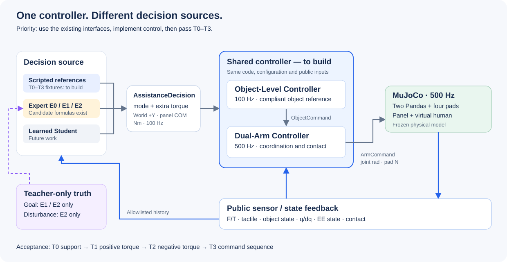

# ENPM 645 — Human–Robot Co-Manipulation

**Next task: implement one controller stack that both the Expert and the future Student use, then validate it in repeatable scenes.**

A human and two Franka Panda arms hold a rigid panel. The policy requests additional assistance about World Y; the shared controller must turn that request into real joint motion and contact forces while maintaining support.

## Swathi's controller assignment

Implement the **Object-Level Controller + Dual-Arm Controller as one shared control implementation**, using the existing two `step()` interfaces. This is one controller stack, not separate controllers for Expert and Student and not a new fourth interface.

1. Read [Swathi's implementation and test handoff](docs/CONTROLLER.md): exact inputs, outputs, model access, limits, and scene tests.
2. Implement compliant object control, dual-arm coordination, contact maintenance, and genuine command/allocation diagnostics.
3. Demonstrate **T0–T3**: support, positive torque, negative torque, and continuous command changes.
4. Integrate **T4–T7** together with Jerry; **T8** is optional. T9 is not defined.

Changing Expert to Student must change only the upstream decision source. Controller code, parameters, observations, and safety behavior remain the same for a matched comparison.



## What exists today

| Available | Not yet implemented / validated |
|---|---|
| Frozen dual-Panda hardware, tactile/F/T/joint logging, three typed interfaces | Full object/arm control and extra-torque tracking |
| Physical support, scripted motion evidence, and executable T0-T8 fixtures/input runner | Calibrated controller thresholds and validated cooperation with an Expert |
| E0/E1/E2 candidate formulas and offline diagnostics | Closed-loop Expert integration, valid demonstrations, trained Student |

The current adapters only forward references and hold nominal joint positions. They are not the requested controller. Existing evidence: [physical checks and videos](results/phase1b/current/README.md) at `37b8c24`, [9 Expert arithmetic/data tests](results/phase1b/expert_math/verification.json). The [fixture verification](results/phase1b/controller_fixtures/verification.json) records input transport, reset, and regression checks; assistance tracking remains unverified.

## Who prepares what

- **Jerry:** repeatable starting scenes, human/disturbance fixtures, scripted torque requests, Expert decisions, logging/label boundaries.
- **Swathi:** the shared controller, model-based calculations, real diagnostics, and T0–T3 execution/report.
- **Together:** fixture integration, calibrated limits, frozen acceptance thresholds, and T4–T7 comparisons. T0-T8 setup and inputs are available in `phase1b.benchmark`. Swathi can plug in her controller; the existing demo suite remains separate regression evidence.

**Done means:** runnable code + reproducible scene tests + numerical evidence and failure reasons. Support alone is not torque tracking. Expert demonstrations are collected only after control and Expert quality pass; learning-data validity is a separate gate. No training, new hardware, 90° flips, or VLM work in this milestone.

## Run and contribute

```bash
uv sync --locked
# T0-T3 fixtures and synchronized inputs; default adapters do not execute assistance:
uv run --locked python -m phase1b.benchmark --output results/phase1b/dev-controller-inputs
uv run --locked python -m unittest phase1b.tests.test_benchmark phase1b.tests.test_expert -v
# Separate physical regression and scripted motion demos:
uv run --locked python -m phase1b.scripts.run_suite --output results/phase1b/reproduction --render
```

Local Python 3.12.11 / MuJoCo 3.3.5, uv, no Docker. Outputs must use new directories; rendering requires ffmpeg. Keep one implementation in `phase1b/`, English documentation, and reviewed branches/PRs. Commit dependency changes with `uv.lock`; version hardware/contract changes and preserve producing commits for results.

[Optional literature and reading status](docs/LITERATURE.md) · [BibTeX](docs/references.bib). Earlier detailed documents remain in Git at `039e835`; code, model assets, and experiment evidence are retained.
