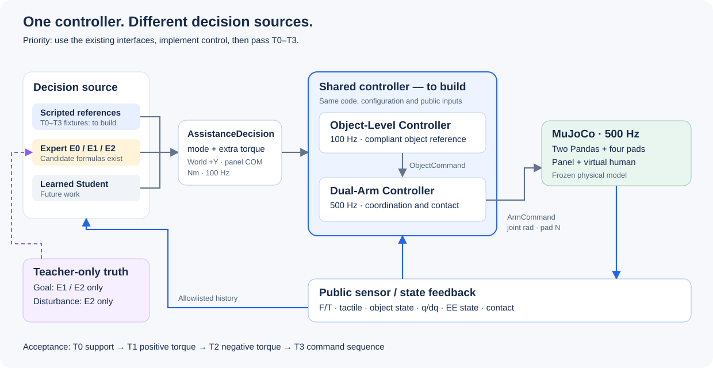

# Expert and data contract

This is the project's design document for Expert decisions, Student inputs, data collection, and evaluation. It records what we have agreed, what we are assuming for the pilot, and what still needs a decision. Controller implementation details belong in [the controller handoff](CONTROLLER.md).

We want a Student to infer useful assistance from physical interaction history. Its primary action is an additional torque about World +Y at the instantaneous panel center of mass (COM), in Nm. It does not predict the Panda joint commands. Expert and Student use the same downstream controller.



## 1. Decisions and assumptions

| Topic | Decision | Current implementation or limitation |
|---|---|---|
| Control ownership | Expert/Policy decides additional assistance. The controller uses public state, basic support, and a consistent compliant response to realize it. | Interfaces exist; full control and assistance tracking remain unvalidated. No downstream loop may pursue a hidden human goal or duplicate the Expert's pitch feedback. |
| Human behavior | For the first pilot, assume scripted Virtual Human behavior approximates the interaction distribution we want to study. | This is a working assumption, to compare with manual trials. It does not certify Expert labels. |
| HOLD | A person may request a stop during motion at any reachable pose, before the original goal is reached. | Adapters latch pose on entry to HOLD. Observable stop recognition and physical stopping control are still missing. |
| Panel information | Assume panel position, orientation, and velocity are available to the policy and controller. | Read from MuJoCo for now. Camera estimation, noise, and latency are later sensing work. Human goals and future states remain private. |
| History | Use at least two elapsed seconds for the primary Student design. | Default online buffer is 201 samples at 100 Hz. Two seconds is an initial choice, not proof of sufficient memory. |
| Student output | Torque regression is the primary learning target. A neural mode classifier is not required by the research question. | The existing execution interface still requires mode. Torque-only deployment needs an explicit public-state supervisor or an interface revision; neither has been selected. |
| Sensors and model assumptions | Standardize F/T sources/frames, separate joint and tactile ablations, and define the valid domain of the single-axis model. | Some profiles exist; the unified profiles and model-domain acceptance thresholds are unfinished. |
| Evaluation | Combine repeatable scripted tests with manual interaction trials. | Fixtures exist. Manual input/annotation tooling, calibrated tracking, and human-interaction evaluation remain to be built. |
| RL | Consider later refinement after controller, initial policy, and evaluation are established. | No RL algorithm, reward, or training run has been selected. |

The Virtual Human produces human behavior and physical forces. The Expert produces robot-assistance decisions. Treating the former as representative does not imply that the latter is correct, executable, or learnable.

## 2. What the Expert computes

Near single-axis pitch motion, with the other degrees of freedom controlled:

$$
J_y\ddot\theta=\tau_h+\tau_d+\tau_b+\tau_a.
$$

Here $\tau_h$ is human torque, $\tau_d$ disturbance torque, $\tau_b$ the base controller's contribution, and $\tau_a$ additional assistance. All torques refer to the same world axis and instantaneous COM. Desired assistance excludes basic support.

The ideal inverse-dynamics relationship is:

$$
\tau_a^*=J_y\ddot\theta_{des}-\tau_h-\tau_d-\tau_b.
$$

It explains why a candidate assistance torque can be calculated when desired motion and the other contributions are known. It does not prove that position servos and frictional contacts can realize it. The full rigid-body relationship also contains inertia-frame and gyroscopic coupling; a finite single-axis result is not enough to establish physical validity.

E1 is the primary candidate teacher, E2 an oracle reference, and E0 the reactive comparison. These are decision strategies above one shared controller.

| Strategy | Information permission | Candidate rule and purpose |
|---|---|---|
| E0: force following | Public object state and reconstructed robot contact F/T, including the public transforms needed to express it at COM | Estimate combined external interaction, filter it, and provide proportional assistance. It cannot separate human intent from disturbance merely by knowing the net torque. |
| E1: goal aware | Public state plus the current teacher-only human goal/mode | Wait for observable rotation guidance, update an internal bounded reference, and provide goal-related assistance. |
| E2: disturbance aware | E1 information plus current disturbance torque truth | Add partial disturbance compensation to E1. It is an oracle comparison, not a guaranteed optimal policy or automatically suitable supervision. |

E0 uses a causal acceleration estimate:

$$
\hat\tau_{int}=J_y\hat{\ddot\theta}-\tau_{r,y}^{measured},\qquad
u_0=k_f\operatorname{LPF}(\hat\tau_{int}).
$$

E1's rotation request, after the observable gate opens, is:

$$
u_1=J_y\ddot\theta_{ref}+K_{p,R}(\theta_{ref}-\theta)
+K_{d,R}(\dot\theta_{ref}-\omega_y).
$$

Its reference advances toward the teacher goal at a bounded rate. In HOLD:

$$
u_{1,H}=K_{p,H}(\theta_{hold}-\theta)-K_{d,H}\omega_y.
$$

This is additional impedance assistance, not the complete inverse-dynamics cancellation above. Base pitch support and damping must be coordinated with these gains.

E2 adds feedforward before output limiting:

$$
u_2=u_1-\lambda_d\tau_{d,y},\qquad 0\leq\lambda_d\leq1.
$$

Each strategy applies torque amplitude and slew limits. Limits must come from controller validation; current test constants are not certified operating limits. In the current generator, UNCERTAIN forces zero assistance, even when this overrides the slew limit; that exception is logged and still needs physical evaluation. E2 does not add disturbance feedforward while UNCERTAIN.

The [reference generators](../phase1b/expert/reference.py) implement these candidate rules. They do not implement a complete online policy adapter or validate cooperation. The rotation gate reduces premature action but does not make all E1 labels observable: hidden mode changes, final goals, and long-lived teacher state can still matter.

## 3. Human intent, teacher state, and robot mode

These are three different records:

| Record | Meaning | Access |
|---|---|---|
| Human intent and goal | What the person wants to accomplish, including an intermediate stop or reversal | Teacher/evaluation only |
| Human target trajectory | The hand target position and velocity used by the spring-damper to generate force | Simulation/teacher only |
| Assistance decision | What assistance is justified now, given the strategy and evidence | Passed to the shared controller |

A moving hand target is not the same as a final goal angle. A task ID is not a moment-by-moment intent label. Declining human force alone does not prove a stop request: the person may simply need less force because assistance is working.

The existing teacher generator requires timestamp-aligned `TeacherGoal(timestamp, mode, angle)` and, for E2, `DisturbanceTruth(timestamp, torque_y)`. Offline annotation requires explicit `ground_truth_intent`, `human_goal_angle`, and `external_disturbance_wrench` arrays. The bridge from the T0-T8 fixtures or manual events to these fields is not complete. In particular, the distinction between final goal and instantaneous target angle, pause semantics, and stop/reversal event timing must be finalized before collecting labels.

The execution modes currently mean:

| Mode | Robot behavior | Torque semantics |
|---|---|---|
| ROTATE_POS / ROTATE_NEG | Allow bounded assistance in a confirmed rotation interaction | Torque may oppose the intended direction to brake. |
| HOLD | Maintain an accepted stopping reference | Additional torque may be nonzero, including during sustained disturbance. |
| UNCERTAIN | Cancel high-level active assistance; retain bounded base support/stability | Additional torque is zero. |

`ground_truth_intent=ROTATE_POS` and `expert_mode=UNCERTAIN` can both be correct when guidance has not become identifiable. C/HOLD-with-disturbance is not another intent class. T0-T3 intentionally use HOLD with scripted nonzero torque to isolate control testing; those decisions are not human-intent demonstrations.

### Stopping and latency

The agreed requirement is that stopping is available throughout the motion, within physical constraints. The current implementation choice is to latch measured pose on accepted HOLD entry, keep that reference, and permit bounded braking while settling. This is not a claim that the accepted pose exactly matches where the person first wanted to stop. How to infer that intended stopping pose from physical cues remains open. Do not continuously relatch a drifting pose or resume toward an old hidden goal after a stop.

Evaluation needs the intended stop time/pose, observable detection time, command application time, and settling time/pose. Report both detection delay and physical stopping displacement. Manual annotation timestamps are observations of an operator's report, not exact measurements of an unexpressed mental event; record annotation uncertainty.

Acquisition time, observation availability, decision time, and actuator time must also be distinguished when sensor/processing delays are introduced. The current 100/500 Hz scheduling contract does not establish camera or human-interaction latency. Delay instrumentation and the criteria for accepted start/stop/reversal cues are pending.

### Does the Student need mode?

The learning target may be simply $O_t\mapsto\tau_a$. Mode can remain useful for Expert design, annotations, and evaluation without becoming a neural classification output.

However, the current `AssistanceDecision` contract still uses mode for HOLD latching and UNCERTAIN behavior. Before torque-only deployment, choose either a causal supervisor using public history or a deliberate execution-interface change. Do not infer mode from torque sign. Supplying hidden teacher mode is permissible only as an explicitly named oracle-mode ablation, not as an end-to-end Student result. This choice is unresolved; the existing interface has not been removed.

## 4. Student observations and history

Record full observations, then select inputs through an allowlist. Panel state is public under the pilot's known-state assumption. Hidden human goals, exact disturbance truth, scenario/task labels, teacher references, future commands, and future observations are excluded.

| Signal | Shape per sample | Units / convention |
|---|---|---|
| Object position / orientation | `(3,)` / `(4,)` | World m / quaternion wxyz |
| Object linear / angular velocity | `(3,)` each | World m/s / rad/s |
| Left and right F/T | `(6,)` each | Force then torque, N/Nm; declared source, frame, and moment center |
| Left and right tactile | `(2,3,4,4)` each | Upper/lower pads, three channels, 4x4 bins; N/bin, not pressure Pa |
| Joint q / dq | `(2,7)` each | Left/right Panda, rad / rad/s; optional Student features |
| Contact state | `(2,)` per gripper | Current contact counts; not contact force |

Joint states remain available to the controller regardless of the Student profile. Static panel geometry, mass, and inertia are known model information; exact human goals are not.

Fix one F/T source for each comparison. Contact-reconstructed local F/T is panel-on-gripper. Transforming it to robot-on-panel at COM requires sign reversal, rotation, and a moment shift. Raw wrist transmitted wrench also contains downstream weight/dynamics. Keep both in the record, but do not mix their semantics. Teacher reference angles and velocities belong to private Expert traces, not Student features.

The primary history is at least two elapsed seconds. At 100 Hz, 201 samples cover `[t-2.0, t]`. The online buffer currently supplies only the available prefix during startup. It does not pad with invented observations or implement a learned-policy warmup strategy. Define startup eligibility/behavior before training and deployment. A rolling history does not require a two-second action delay, and two seconds may still be too short to reconstruct a much older HOLD reference.

The planned ablations are F/T+object, +joints, +tactile, and +both. Current offline tools implement `ft_object`, `ft_object_joints`, and `ft_object_joints_tactile`; the independent +tactile profile is missing. The online profile named `baseline` already includes tactile and contact counts. Unify these definitions before comparing models. Any derived F/T transforms must use declared public inputs consistently; E0's helper currently uses end-effector poses that are not in the default Student feature profile.

Set a valid domain for the pitch approximation before accepting labels. Current code records off-axis angular velocity but does not automatically reject a candidate when coupling becomes significant. General 3D angular velocity Y is not always the derivative of the selected pitch parameter. Thresholds and the response outside that domain remain to be defined.

## 5. Data contract and label eligibility

Each 100 Hz transition preserves this order:

```text
Observation_t
  -> AssistanceDecision_t
  -> ObjectCommand_t
  -> five ArmCommands / physics steps at 500 Hz
  -> Observation_t+0.01
```

Each arm substep records its command time, decision/object-reference source time, and post-step measurement time. A label at time t may use only information available by t under that strategy's permissions. The subsequent observation is an outcome, never a feature for the preceding action.

| Stored block | Required meaning |
|---|---|
| observations / next_observations | Public measurements before and after the transition |
| decisions | Timestamp, mode, requested additional torque, source, validity, optional confidence |
| object_commands | World COM pose reference (xyz+wxyz), twist (angular then linear), assistance wrench (force then torque), impedance settings |
| controller | Joint position targets in rad, pad commands in N, actuator response, command/source/realized timestamps |
| diagnostics | Physical failures, contact, saturation, limits, and validated execution diagnostics when available |
| privileged | Human goals/targets, applied human/disturbance forces and wrenches, labels and scenario context |
| supervision | Formal teacher labels and eligibility masks |
| render_states | Simulator state needed to inspect the recorded motion |
| metadata | Identity, versions, model/config/source hashes, timing, component configuration and provenance |

Full episode provenance should include panel properties, grasps, human impedance/limits, disturbance protocol, Expert gains and bounds, controller identity, observation profile, reset state, and quality/failure reasons. Exact task schedules and manual annotations are private experiment context. Never feed arbitrary metadata or episode time as a shortcut for a fixed schedule. Not all provenance fields are populated uniformly yet; fixture metadata and the older Expert sidecar metadata need reconciliation.

The current [pipeline](../phase1b/pipeline.py) logs these transition blocks. Its `metadata.experiment` stores benchmark context; that is not a Student input. Missing diagnostic quantities use NaN with false validity, not fabricated zeros.

The [Expert sidecar](../phase1b/expert/data.py) keeps private candidate traces separately from formal supervision. A candidate trace records Expert ID, mode, gate/direction, internal reference angle/velocity/acceleration, raw and limited torque, saturation/slew flags, and invalidity reasons. Confidence is `None` unless a calibrated estimate exists.

| Eligibility | What it establishes |
|---|---|
| candidate_valid | A candidate was produced under the mathematical/interface rules; not a physical or teacher-quality guarantee. |
| execution_valid | Required execution and physical checks passed; criteria and promotion path are not implemented yet. |
| supervision_eligible | Execution and teacher-quality requirements were met for formal supervision; this is not proof of learnability. |

`AssistanceDecision.valid` is not `expert_label_valid`. Current candidates keep execution and supervision eligibility false. Formal `expert_assist_torque_ref` stays NaN and formal validity masks stay false. Candidate values remain available in private traces for diagnostics. An actual zero assistance request is different from an unavailable label.

Requested extra torque, allocated contact wrench, executed joint command, and measured total contact wrench must remain distinct. The measured wrench includes base support. A difference from a zero-assistance run can be informative, but after trajectories diverge it is not a same-state measurement of extra assistance. The baseline decomposition, estimator, and valid tracking windows must be specified before reporting assistance RMSE. Current allocation/tracking fields are still unavailable.

## 6. Collection and evaluation

Start with shadow candidates on recorded interactions. E0/E1/E2 can inspect the same public trajectory under their respective information permissions, but their recommendations did not cause that trajectory. Shadow annotation is useful for checking signs, gating, limiting, and label conflicts; it does not demonstrate closed-loop benefits.

After controller tracking is validated, run each strategy in closed loop with the same initial conditions, human goals/impedance, and disturbance conditions. Let actual human force change with panel response. Replaying an identical human-force trace across strategies would remove the interaction effect we want to measure.

Manual pilot trials should control the virtual hand target through its spring-damper, not teleport the panel or prescribe Panda trajectories. Record the input device/mapping, raw input, requested intent/goal, event timestamps, and annotation uncertainty alongside the standard data. This can reveal how scripted and manual behavior differ and how a person uses the assistance. It does not directly label the optimal robot torque. The manual input UI and event logger are not implemented.

Before training collection, specify ranges and sampling rules for direction, angle, speed, onset, intermediate stops, pause length, reversals, human impedance, and disturbance timing/magnitude. Keep the frozen hardware and grasp geometry. Choose held-out conditions and manual sessions in advance; split by episode and condition/session, not overlapping windows. Fit normalization on training data only. Sampling ranges, dataset sizes, and thresholds are still pending; repeating the fixed benchmark scripts is not sufficient distribution coverage.

| Evaluation | Evidence needed |
|---|---|
| Physical execution | Validated extra-torque tracking where identifiable, contact stability, limits, saturation and numerical health; T0-T3 are the starting fixtures. |
| Cooperation | Task accuracy, human force burden, start/stop/reversal delay, stopping drift/overshoot, false activation and failures; T4-T8 plus manual trials. Compare with support_only and E0. |
| Learning | Prediction error against eligible labels on held-out episodes, observable label consistency, and closed-loop cooperation after replacing the Expert with the Student. |

Human force burden can use `integral ||F_h||^2 dt`, RMS, and peak force; these are not metabolic energy. Report intended-stop error as well as error around the later accepted HOLD reference. Manual labels of intent and preference complement physical measurements; they cannot replace assistance tracking validation.

Before training, examine whether similar public histories require conflicting teacher torques. The [learnability tool](../phase1b/expert/learnability.py) finds cross-episode neighborhoods and reports coverage, label variation, and sign conflicts. It is a finite-sample diagnostic, not a conditional-variance estimate or proof of learnability. Report coverage when adding tactile dimensions, exclude same-episode leakage, and keep E1/E2 and different teacher configurations separate. E2 truth access and E1 hidden goals/internal state can create ambiguity even when execution succeeds.

RL refinement remains a future option. Define cooperation metrics and verify a controller and initial policy first. Any later reward must address task accuracy and stopping behavior as well as human effort. No reward, learning algorithm, or training implementation is agreed here.

## 7. Implementation status and decisions still needed

| Item | Status |
|---|---|
| E0/E1/E2 reference math, private candidate traces, causal-window diagnostics | Implemented for candidate analysis |
| Three-layer transport, joint/sensor logging, T0-T8 fixture inputs | Implemented; default adapters do not execute assistance |
| Two-second default history | Implemented at `d73de9e`; its 32-test run covered history and existing contract/integration tests |
| Teacher intent/goal/trajectory bridge and online E1/E2 adapter | Pending; `ReferenceGenerator.step` is not a ready `predict(history)` policy |
| Manual input, annotations, latency instrumentation | Pending |
| Full shared controller, allocation, incremental torque tracking | Pending validation/implementation |
| Formal label promotion, Student training, RL | Not implemented |

Next design decisions are: the teacher goal/intent/event mapping; start/stop/reversal cues and their delays; the torque-only execution behavior and startup/memory policy; unified sensor profiles and single-axis validity criteria; and the sampling plan, tracking estimator, and acceptance thresholds. HOLD-at-any-reachable-pose and the other accepted requirements above do not by themselves resolve these implementation choices.

This document clarifies the design. It does not promote existing candidates, certify controller performance, or claim that scripted behavior matches measured human behavior.
