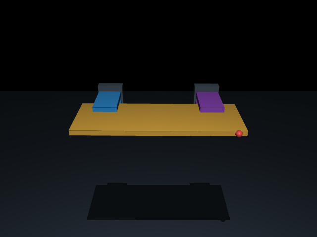

# Frozen simulation hardware v1

**目前硬體固定為兩個相同的簡化夾爪，加上一個虛擬人手作用點。**

機器可讀規格：[hardware_v1.json](../phase1a/config/hardware_v1.json)。ID=`enpm645-edge-dual-gripper-virtual-human`，version=`1.0.0`。它綁定 [scenario v2 的位置配置](SCENARIO_V2.md) 及實際 MJCF 的 hashes，由 compiled MuJoCo model 擷取，沒有另選商用夾爪、機械手臂或人手模型。



藍色：Robot L；紫色：Robot R；紅球：虛擬 human site；黃色：panel。上下 pads 由板材邊緣夾入，視角會遮住 lower pads。實景圖僅隱藏 tactile plugin debug overlays，實體 collision geometry 沒有被隱藏或修改。

## Robot L/R：相同夾爪、不同固定 nominal placement

| 項目 | 固定值 |
|---|---|
| 模型 | Free root + upper/lower 兩個 prismatic pads；沒有完整手臂 / IK |
| 每個夾爪總質量 | **0.50 kg**：root/flange 0.30 kg + 兩片 pad 各 0.10 kg |
| Root/flange box 尺寸 | 0.10 × 0.03 × 0.10 m；body-local center=[0,+0.095,0] m |
| Root principal inertia | [0.0002725,0.0005000,0.0002725] kg·m²；inertial origin=[0,+0.095,0] m |
| 每片 pad 尺寸 | **0.09 × 0.14 × 0.02 m** |
| 每片 pad principal inertia | [0.000166666667,0.000070833333,0.000230833333] kg·m² |
| Pad motion | 沿 local Z；upper range=[-0.006,+0.015] m，lower=[-0.015,+0.006] m |
| 名義 jaw gap | 0.02 m，與 panel 厚度相同；由 slide ranges 推得幾何開口範圍 0.008–0.050 m |
| Slide damping / armature | 20 N·s/m / 0.02 kg；frictionloss=0、joint stiffness=0 |
| 名義 preload commands | [left upper,left lower,right upper,right lower]=**[-40,+40,-40,+40] N** |
| Pad motor command bounds | upper [-80,0] N；lower [0,+80] N；motor gear=1 |
| Virtual root drive limits | 每端 force norm ≤35 N，torque norm ≤3 Nm；這是模擬限制，不是商用馬達額定規格 |
| Contact friction | [1.0482960672343025,0.005,0.0001]；condim=3 |
| Contact solver parameters | solref=[0.01,1]；solimp=[0.95,0.99,0.001,0.5,2] |
| 位置 | Robot L=[-0.20,+0.10,0]、Robot R=[+0.20,+0.10,0] m，panel-local |

Root freejoint 沒有位置鎖；pad preload 是名義起始控制，不是量測 contact force。Controller 可以在已固定的 motor/drive bounds 內改變命令，不能把「硬體固定」誤解為 actuator output 永遠不能變。

## 感測硬體抽象

- 每端獨立 F/T：由該端真實接觸 wrench 重建的模擬量測；root-local、about root、panel-on-gripper，順序 Fxyz/Txyz。沒有額外模擬實體 F/T transducer 的質量、噪聲或頻寬。
- 每片 pad 使用 `mujoco.sensor.touch_grid`，3 channels × 4 × 4 angular bins，共 48 values；每個夾爪兩片 pads 共 96 values。
- Plugin config 固定為 nchannel=3、size=4 4、fov=110 85、gamma=0。
- Upper sensor 在 pad-local [0,0,+0.08] m、quaternion [1,0,0,0]；lower 在 [0,0,-0.08] m、quaternion [0,1,0,0]。Sensor site 位置不是 contact point。

## 單一虛擬人手

| 項目 | 固定值 |
|---|---|
| 模型 | **單一 point spring-damper interaction**；沒有手指 collision geometry 或獨立剛體質量 |
| Attachment | panel-local **[+0.27,-0.10,0] m**，對側長邊表面 |
| Stiffness | **98.21089225920257 N/m** |
| Damping | **7.3012286492091985 N·s/m** |
| Force norm limit | **50 N** |
| Target speed limit | **0.35 m/s** |
| 紅球 marker radius | 0.012 m；只是 site 視覺標記，不參與 collision |

人手可以依 A/B/C 改變目標軌跡；attachment、spring/damper 和限幅固定。既有模型沒有真正的人手抓取接觸、指尖摩擦或剛體手掌，不能把它說成已完成的人手硬體模擬。

## 開發邊界與自動檢查

**之後可以變：** controller 演算法、desired assistance torque、合法範圍內的 actuator commands、expert 策略、policy；允許設定內的人手 target trajectory。這些應記錄在實驗設定或 controller 版本中。

**不能在這個硬體版本中靜默改：** body/pad geometry、mass/inertia、joints、friction/contact solver、sensor frames/plugin config、motor gear/limits、nominal grasp placements、人手 attachment/stiffness/damping/limits、增加人手或 gripper。

`scenario_registry.json` 綁定 hardware file hash。載入場景與開始 episode 時，`hardware_binding()` 會檢查規格檔 hash、model/config binding，以及實際 compiled hardware snapshot。每個新版 episode 都保存 `hardware_id`、`hardware_version`、`hardware_hash`；dataset validator 檢查一致性。

測試會刻意修改 mass、friction、人手 stiffness 和規格檔內容，驗證會拒絕這些變更。這是可重現性契約，並不是對任意 Python 程式的安全 sandbox。若真的要改硬體，建立新的 hardware version；若同時改抓點或場景，也建立相應的新 scenario version，再重新驗證。

Controller 的 `observation.calibration['robot_hardware']` 提供左右夾爪 body masses/inertias、joints 與 geometry；`grasp_semantics` 提供名義握點與 contact patch 定義。Human 的即時 goal、施力與 scenario label 仍不會送入 controller/policy。

```bash
uv sync --locked
uv run --locked python -m unittest phase1a.tests.test_contracts phase1a.tests.test_edge_geometry -v
uv run --locked python -m phase1a.scripts.run_edge_scene --output results/phase1a/reproduction-hardware
```

實際 robot grasp frame 仍會有順應偏移（這批最大約 1.05 cm），完整結果見 [新版驗證報告](../results/phase1a/edge_v2/report.md)。固定 hardware/nominal grasp 並不等同於零滑移、已完成 force allocation、或有效 expert labels。
