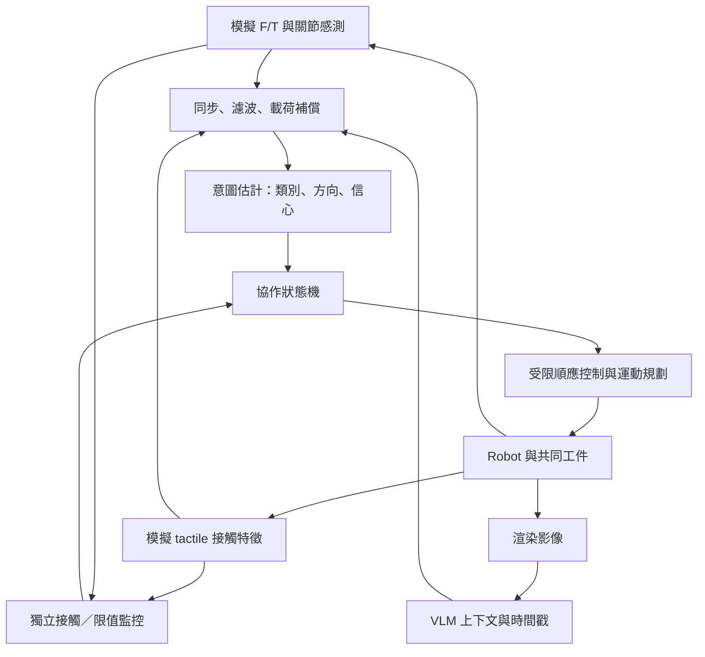

# 專題概念：無語音的人機協作翻轉

> 這是 2026-10-10 的初版三模態構想，以下保留作為設計背景。後續已收斂為 CPU MuJoCo、F/T + tactile、雙握持端與分層力矩介面，VLM 不在目前 MVP。最新 [Phase 1A 規格](../phase1a/specification.md) 將工作拆為 Track A（固定場景與資料管線）及 Track B（model-based allocation/control）；Track A 已通過 [Data Pipeline GO / Controller Integration Ready](../results/phase1a/report.md)，Track B 接口見 [CONTROL_HANDOFF](CONTROL_HANDOFF.md)。原 [v2 系統架構](system-architecture-v2.md) 與 [v2 物理報告](../phase0_v2/report.md) 保留作為基礎。

## 場景與問題

人與單支機械手臂各握住剛性工件的一端。人透過施力、手部與物體運動表達要開始旋轉、改變方向或停止；機器人維持支撐並提供順應協助。焊接／噴漆是應用動機，第一階段只演示工件重新定向。

**使用者已確認：先在模擬環境進行，假設 F/T、tactile 與影像可用；視覺語意來源是 VLM。** 以下範圍與實驗設計是供團隊討論的初版建議。

**候選研究問題：**相較於 F/T + 物體運動 baseline，加入 tactile 接觸狀態與 VLM 視覺上下文，是否能在單軸共同翻轉時減少錯誤啟動、縮短意圖偵測延遲，或改善握持穩定性？

P01 示範了力線索驅動的箱子轉動，但使用雙臂；P02 的人機驗證限於平面 3-DoF。因此這兩篇提供方法起點，尚未回答上述單臂三模態問題。[P01](../01_literature/papers/gienger-2018-contact-changes.md)、[P02](../01_literature/papers/mielke-2024-planar-co-manipulation.md)

## 第一版範圍

- 固定形狀／質量的剛性板材，先限制一個旋轉軸與固定握點。
- 以物體座標系定義 `ROTATE_POS`、`ROTATE_NEG`，避免不同視角下 CW／CCW 混淆。
- 操作意圖為 `HOLD`、`ROTATE_POS`、`ROTATE_NEG`、`STOP`、`UNKNOWN`。`STOP` 表示終止正在進行的旋轉；`HOLD` 是穩定支撐。`UNKNOWN` 是模型拒絕判斷。
- 控制狀態另有 `PAUSE/FAULT`，不把滑移或感測失效當成人類操作意圖。
- 先測 ±90°；180° 才是真正把對面朝上的翻面目標，需先確認手腕、物體與人的幾何可行性。
- 任意曲面、任意 6-DoF、換握與多物體泛化列為後續延伸。

## 各模態的角色

| 來源 | 提供什麼 | 第一版用法 | 邊界 |
| --- | --- | --- | --- |
| F/T + proprioception | 末端 wrench、關節狀態、載荷變化 | 旋轉起始／方向的即時線索 | 需考慮重量、慣性與座標轉換 |
| Tactile | 機器人夾爪與物體的局部接觸 | 接觸穩定性、滑移與壓力變化 | 不直接量到另一端的人手力 |
| Rendered vision + VLM | 可見的人手、工件朝向與情境 | 輸出有時間戳的有限類別／信心作為上下文 | 是待驗證的專題設計；這份清單尚無直接的共同翻轉 VLM 證據 |

F/T 動態分離可參考 P06；觸覺保護層可參考 P07。P04／P05 提供視覺融合思路，但都不是 VLM 翻轉方法。[P06](../01_literature/papers/bai-2025-object-mass-human-wrench.md)、[P07](../01_literature/papers/feng-2026-tactilereflex.md)、[P04](../01_literature/papers/wong-2024-vision-tactile-intention.md)、[P05](../01_literature/papers/mohandes-2023-handover-fusion.md)

## 建議系統

借用 P01 的分層與 readiness 思路，先用可解釋的狀態機：保持支撐 → 偵測候選意圖 → 確認方向與握持 → 協作旋轉 → 停止／重新判斷。意圖不明或模態衝突時降低主動協助，保留支撐；接觸失效時需有可落地的恢復／支撐策略。這是設計草案，沒有控制穩定性或實體安全的驗證。

VLM 建議低頻提供上下文，由快速感測與控制迴路維持運動。同步記錄推論延遲與訊號 age；過期結果回到 UNKNOWN，不直接將自由文字轉成關節命令。

## 模擬感測與 ground truth

1. 人類代理先透過共同物體的接觸點施力／力矩；不能直接把工件旋到答案，再當作協作成功。
2. F/T 與 tactile 通道加入各自的噪聲、採樣率、延遲與缺失。即使源自相同 physics contacts，也要標明它們的相關性。
3. 初版 tactile 可是 taxel 壓力、法向／剪切力或滑移 proxy；若沒有影像式觸覺模型，就稱為「模擬接觸特徵」。
4. VLM 只能看到渲染影像與預先固定的任務描述；不提供 trial 指令、未來目標或意圖真值。
5. 人側命令、精確物體狀態、理想 wrench 等真值用於評估。任何真值輸入的版本都明確標為 **oracle baseline**。
6. 保存場景、seed、物體參數、human-policy 與 sensor 設定。訓練／測試按整段 trial 或 policy 分割，避免相鄰時間窗洩漏。

## 可比較的版本

| 版本 | 輸入／方法 | 要回答的問題 |
| --- | --- | --- |
| B0 | F/T 門檻 + 固定順應控制 | 簡單方法能完成多少？ |
| B1 | F/T + 可感測物體運動 + 短時序估計 | 時序資訊是否改善歧義？ |
| B2 | B1 + tactile | 意圖辨識或握持穩定性是否改善？ |
| B3 | B1 + VLM context | 視覺語意是否有額外價值？ |
| B4 | B1 + tactile + VLM context | 三模態的收益是否抵得過延遲？ |

比較時保留相同低階控制器與場景；另做 VLM 延遲／遮擋及 tactile 缺失測試。直接物體 pose 視覺估計可作為額外比較，檢查 VLM 是否只是重述幾何資訊。

## 初版評估

| 指標 | 建議定義 |
| --- | --- |
| Intent macro-F1 | 對四種有效意圖計算；UNKNOWN 另報 coverage／拒絕率 |
| Detection latency | 从人側施力命令 onset 到首次持續有效的正確判斷；報告漏檢與提前誤觸發 |
| False activation | 非旋轉 trials 的誤啟動比例，另報每分鐘誤啟動數 |
| Task success | 到達目標角度誤差範圍並維持指定時間，未掉落／超限 |
| Effort proxy | 模擬 human-agent wrench／work；不能稱為真實人的主觀負擔 |
| Contact performance | 滑移、掉落、峰值 wrench 與恢復次數 |
| Runtime | 各模態推論延遲、資料 age、控制頻率 |

角度容差、確認時間窗與限值在測試前定義，不能看完 test 結果才調。模擬中的人類代理驗證機械與訊號假設，不能證明真實使用者覺得自然、舒適或理解機器人。

## 下一步決策

- 選定模擬器、單臂與夾爪模型，確認可用力控／速度控制介面。
- 畫出旋轉軸、握點與支撐幾何，先驗證 ±90° 工作空間。
- 決定人類代理的實作方式與意圖 ground-truth 定義。
- 決定 tactile representation、VLM、影像視角與輸出 schema。
- 先實作 B0，再逐一增加模態；避免同時改模型與控制器。

## 證據限制

這是課程專題的概念草案與定向文獻整理，不是全面／系統性文獻回顧，也不主張新穎性已成立。9 篇論文的閱讀範圍見各筆記與 [查核紀錄](../01_literature/search-log.md)。由 Codex 輔助整理，研究問題與實驗參數仍由團隊決定。
