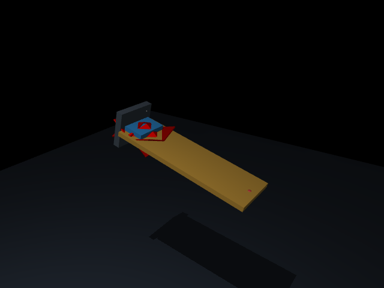
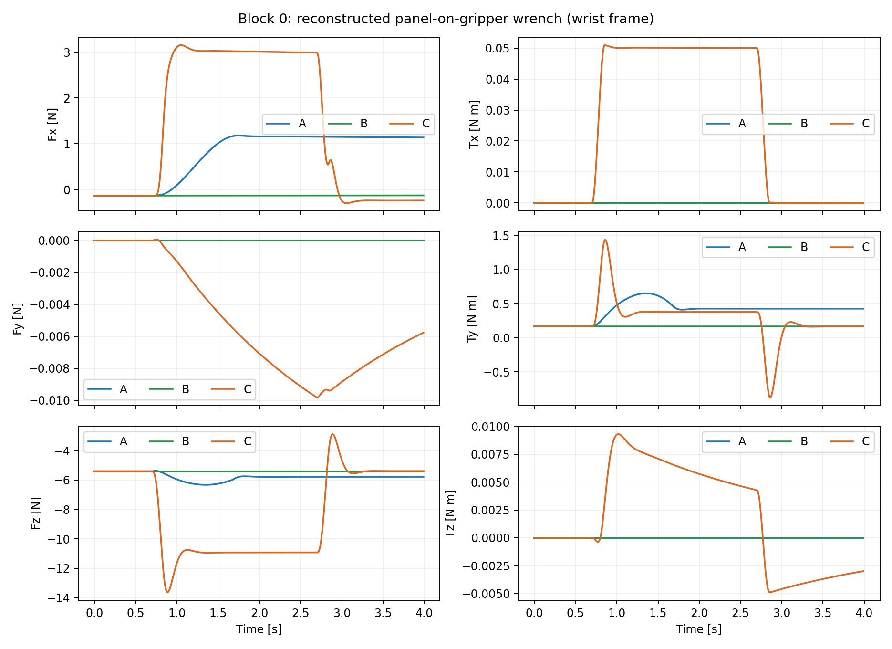
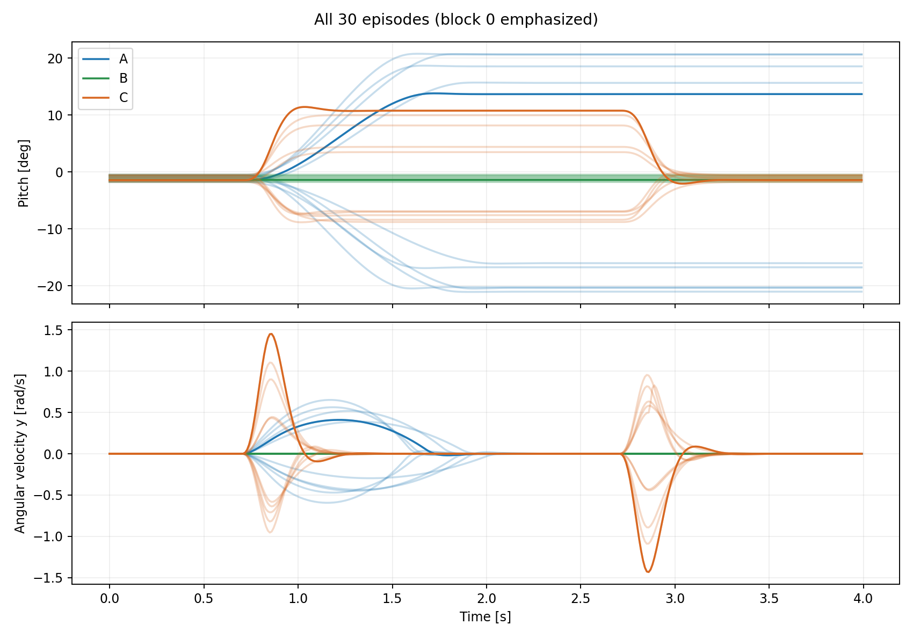
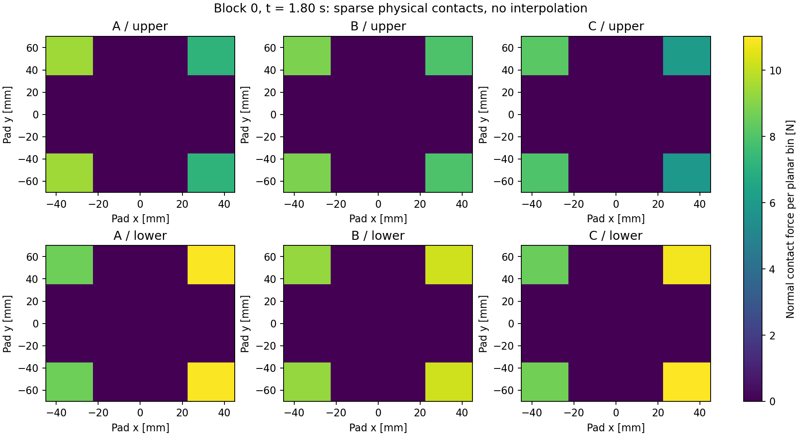
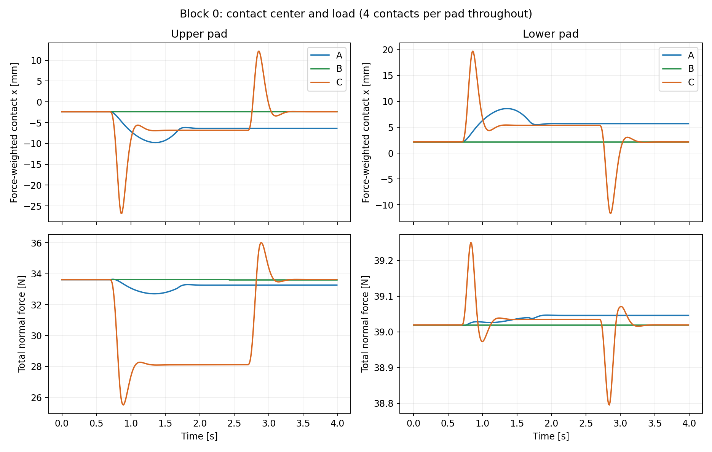
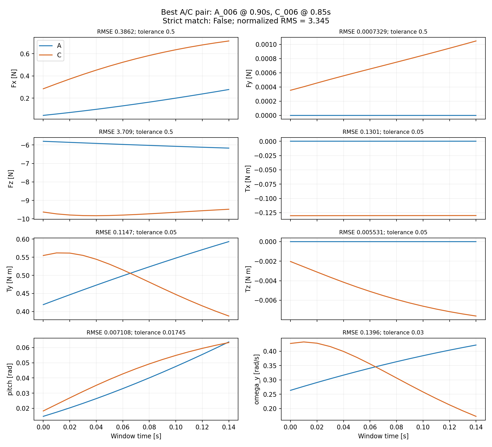
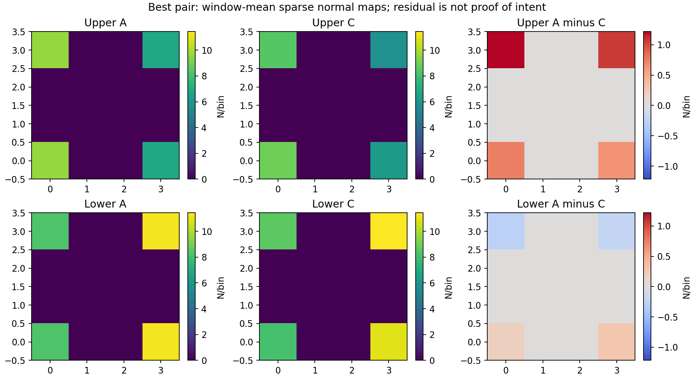

# Phase 0 — Tactile Observability 實驗報告

**判斷：NO-GO。此模型已能產生可信來源的接觸訊號，但尚未證明 tactile 相較 F/T + object state 有額外的意圖辨識資訊，不應直接進入意圖辨識訓練。**

本報告依實際執行的 `results/pilot/` 撰寫。A/B/C 各 10 episodes，4 s/episode、100 Hz，共 12,000 筆同步樣本；另外執行物理負對照、dt 減半及單回合重播。這是固定支架、剛性板材與簡化人手的 simulation pilot，尚無實體感測器或完整協作控制器。

## Q1. 是否成功建立真正的 Panel–Gripper Contact Simulation？

**有，在本次簡化場景與已測參數內成立。** 板材 0.6×0.2×0.02 m、1 kg，具 free joint；兩個 pad 用滑動關節施加預壓，接觸與摩擦由 MuJoCo 求解，沒有 weld。人手 spring-damper 與環境外力透過 `mj_applyFT`，初始化後不改寫物體位姿。

| 檢查 | 實際結果 | 可支持的結論 |
| --- | --- | --- |
| 全部 30 episodes | 每側 4 個承載接觸點；0 接觸遺失、0 地板碰撞、0 MuJoCo warnings | 本參數範圍內保持接觸 |
| 最大接觸穿透 | **0.2972 mm** | 有軟接觸穿透，沒有宣稱零穿透；相對 20 mm 厚度約 1.49% |
| 最大板材線加速度 | **4.1974 m/s²** | 未見數值爆炸；不是硬體安全保證 |
| 線力平衡最大殘差 | **6.77×10⁻¹⁴ N** | contact force 方向及取樣時序與引擎動力學一致 |
| 接觸 generalized force 重建 | 全回合通過 `<10⁻⁸` 的檢查 | 接觸 frame 轉換、作用方向與引擎 constraint force 一致 |
| 關閉 pad 接觸並關閉人手 | tactile 與接觸數皆為 0；0.2 s 後板材由 z=0.8 降至 **0.6032 m** | 支撐確實依賴接觸，不是隱藏 weld 或人工 tactile |
| C_000 的 dt：2 ms → 1 ms | pitch RMSE **0.0001071 rad / 0.00614°**；最大單軸力 RMSE **0.00801 N**、力矩 **0.00242 N m** | 此單回合的步長敏感性較小；尚非完整參數收斂研究 |
| 完整 A_000 重播 | observations、privileged、diagnostics 全部數值最大差 **0** | 同環境、同 seed 的確定性重現 |
| 一鍵全流程重現 | 另跑 30 episodes，**810 個 arrays 完全一致**；134 個結果檔 byte-for-byte 相同 | README 的一鍵指令已實際跑通；同 seed 重跑不算額外獨立樣本 |

支架限制平移及 roll/yaw，pitch 有彈簧與阻尼；支架能承擔負載，這個作用不可誤稱為 tactile 訊息。F/T 僅重建板材對 pad 的 contact wrench，沒有把整個支架反力算入。力平衡驗證是引擎內部一致性檢查，**不是獨立實體物理校正**。

場景快照：金色板材、藍色 pad、灰色 fixture；紅色標記包含 plugin 視覺化及握點，不是人手模型。

## Q2. Wrist F/T 能觀測哪些交互作用資訊？

可以觀測板材傳到夾爪的總負載及其力矩變化，包含重力分擔、旋轉慣性、人手與外部擾動的合成效應。**不能僅由合成 wrench 唯一分解「人想轉」或「人想保持、環境在推」。** 本次訊號標記為 `reconstructed_contact_wrench`，不是獨立 measured wrist F/T。

自然情境下三組已明顯不同。下表為每個 episode 相對其 settle 後起點的最大變化，再列 10 個 episodes 的範圍；不是每一時間點的範圍。

| 量 | A：人主動旋轉 | B：維持 | C：維持＋擾動 |
| --- | --- | --- | --- |
| 最大 pitch 偏移 | 14.66–21.92° | 0.000345–0.001342° | 4.90–12.86° |
| 最大合力變化範數 | 1.45–2.19 N | 0.00177–0.00570 N | 3.65–10.03 N |
| 最大合力矩變化範數 | 0.405–0.745 N m | 0.000007–0.000093 N m | 0.401–1.276 N m |
| 最大單側接觸中心位移 | 5.88–11.41 mm | 0.000093–0.000399 mm | 6.98–24.45 mm |
| 最大接觸切向相對速度 | 0.199–0.641 mm/s | 0.00615–0.01915 mm/s | 0.398–3.264 mm/s |

C 的手部目標一直維持，有限剛性造成暫時偏轉；外力移除後 final pitch 與起點差約 0.0013–0.0156°。**物體發生旋轉不等於人的 intent 是 ROTATE。** B 沒有另加人手抖動，因此過於理想，不能據此預測真實 HOLD 的辨識難度。

## Q3. Spatial tactile 是否提供額外可觀測資訊？

**能觀測到局部接觸力重新分配，但「對意圖辨識有額外資訊」尚未成立。** 官方 touch_grid 可用，另保存每個真實接觸的位置／法向與切向力，以及未插值的平面分箱。下圖統一色階、同一個 block、t=1.8 s，顯示上下 pad 接觸力的改變；接觸中心也隨條件移動。

這裡每側只有 4 個 box 接觸點，4×4 網格大部分是零；調高網格解析度不會增加物理觀測維度。圖上值是 **N/bin**，不是壓力。官方 plugin 使用角度分箱；圖中的平面分箱是同批接觸的另一種明確定義，兩者都保存供檢查。不能把 sparse box contacts 解讀成橡膠／GelSight 的連續壓力或形變圖像。[官方 touch_grid 定義](https://github.com/google-deepmind/mujoco/blob/3.3.5/plugin/sensor/README.md)

自然情境的接觸差異同時伴隨總 F/T、角度與運動差異；也可能是預期的接觸力矩分配。兩個感測通道都源自同一套 contact solver，不能因為 heatmap 不同就宣布有新增的「意圖資訊」。

## Q4. A/C 受力與物體狀態接近時，是否仍有 tactile 差異？

**目前無法回答一般的 A/C 條件問題：本批自然資料沒有合格匹配。另做的合外力矩等價負對照，則沒有可用差異。**

### 4.1 自然 A/C 的量化匹配

在每一個同 seed block 內，搜尋 A/C 各 31 個 150 ms 時間窗，起點 0.85–2.35 s、間距 50 ms，共 **961 個候選配對/block、9,610 個候選配對**。這只比較外力已啟動的範圍，不用事件前「兩者都沒動」的片段假裝匹配成功。相鄰時間窗重疊，不視為獨立樣本；最後每 block 只報 1 個最佳配對。

以整段 15 samples 逐點計算 6 維 F/T、pitch、world-y angular velocity 的 RMSE，非僅匹配平均值。每個分量都必須通過以下工程容差：力 0.5 N、力矩 0.05 N m、pitch 1°、omega_y 0.03 rad/s。這是本次分析設定，並非硬體噪聲校正或預先註冊的統計標準；沒有為取得正面結果而放寬。排序分數為八個 `RMSE/tolerance` 的 RMS；即使分數小於 1，仍需每軸個別合格。

**結果：0/10 blocks 合格。容差縮為 1/2、1/4 時，也都是 0/10。** 最接近的是 A_006 `[0.90,1.05)` s 對 C_006 `[0.85,1.00)` s：

| 匹配量 | RMSE | 容差 | 合格 |
| --- | ---: | ---: | --- |
| Fx | 0.3862 N | 0.5 N | 是 |
| Fy | 0.000733 N | 0.5 N | 是 |
| Fz | **3.7089 N** | 0.5 N | 否 |
| Tx | **0.1301 N m** | 0.05 N m | 否 |
| Ty | **0.1147 N m** | 0.05 N m | 否 |
| Tz | 0.00553 N m | 0.05 N m | 是 |
| Pitch | 0.4072° | 1° | 是 |
| omega_y | **0.1396 rad/s** | 0.03 rad/s | 否 |

此配對的 planar-normal grid RMSE 是 0.3820 N/bin、shear 0.02256 N/bin；官方 plugin 全通道 RMSE 0.2213 N/bin。每側法向分布先各自正規化再比較，平均 L1=0.03881；接觸中心座標 RMSE 1.8346 mm；總法向力 RMSE 2.6074 N。**因 Fz、Tx、Ty 和角速度未匹配，這些差異不能歸因於不同 intent。**

預壓、摩擦、Kh、Dh、初始狀態已透過同 block 固定；接觸數始終每側 4，所以此處不是接觸數量變化造成。但局部負載仍有差異，完整 6-DoF 位姿／速度歷史也沒有匹配：最佳配對 position-coordinate RMSE 1.3574 mm。另因 C 擾動有離軸 y 位置而 A 人手在中線，部分軸向差異可能只是生成器的幾何線索。用這批資料直接訓練分類器會有捷徑風險。

### 4.2 相同合外力矩、不同施力位置的負對照

額外用兩份完全相同的模型與初始狀態跑 3 s。一份把人手力施加在握點；另一份在板材 COM 施加相同力，再補 `τ=(p_hand−COM)×F_hand`。兩份模型保留相同重力及夾爪邊界條件。這是 **wrench representation 的物理一致性負對照，不是另一個真正的 C/HOLD episode**；第二份人手模型輸出被 override，不可拿它冒充人手維持姿態的實驗。

| 觀測 | 全時間／分量最大絕對差 |
| --- | ---: |
| F/T | 1.87×10⁻¹³（N 或 N m，依分量） |
| 物體 pose | 1.11×10⁻¹⁵（m 或 quaternion component） |
| 物體 velocity | 5.96×10⁻¹⁵（rad/s 或 m/s） |
| touch_grid | **1.15×10⁻¹³ N** |
| 平面接觸圖 | **1.15×10⁻¹³ N** |

差異在浮點誤差量級。這支持「同一理想剛體、同合外力矩歷史、同接觸邊界條件，不能單靠施力位置改寫就得到來源線索」。它**不證明所有 A/C 場景或所有 tactile 感測器都不可辨識**，也不能補足自然資料沒有合格匹配的缺口。

## Q5. 是否足以進入 Intent Recognition？

**NO-GO，尚未達到本次觀測性門檻。** 物理與資料管線可重現，但研究假說沒有得到足夠支持：

- 自然資料的力、運動與接觸分布同時變化，F/T alone 已可能分開場景。
- 所有 A/C block 的嚴格匹配皆失敗，無法估計控制 F/T + state 後 tactile 的額外貢獻。
- 等價合力矩負對照沒有留下可用差異；這是預期物理結果。
- 接觸模型僅 4 points/pad、沒有材料形變或硬體校正；訊號無噪聲，object state 為 oracle，尚無真人變異。

沒有訓練 Logistic Regression，也沒有宣稱 accuracy、協作控制成功、90° 翻轉或真實機器人可部署。這裡的 NO-GO 是「暫不進入意圖訓練」，不是否定原始人機協作專題。

## Q6. 下一階段應優先做什麼？

**先改善小型對照與接觸模型的驗證，不優先加入完整機械臂。** 若團隊繼續探索，第一個有意義的步驟是在現有 fixture 中調整 A/C 的施力與幾何，取得真正合格的 F/T + 完整 object state/history 配對，並延續相同預壓與無接觸負對照。接著才判斷有物理依據的柔順 pad／微滑移機制是否提供穩定差異；不能僅加密網格或人工畫 tactile pattern。

若在可辨識性對照下仍無差異，應重新界定目標：tactile 可用於握持／滑移監測，人的操作意圖可能需要人手運動、任務上下文等其他來源。這是後續選項，**本次沒有擴大實作視覺、完整手臂、RL 或大型模型**。

## 證據位置與限制

- [參數、環境與重現指令](README.md)
- [全回合統計](results/pilot/episode_summary.csv)
- [10 組最佳 A/C 配對及每軸 RMSE](results/pilot/matched_pairs.csv)
- [數值摘要](results/pilot/analysis.json)
- [物理對照與重播結果](results/pilot/physics_controls.json)
- [程式／資料 SHA-256 與全流程重現核對](results/pilot/provenance.json)
- [模型 MJCF](models/tactile_pilot.xml)，SHA-256：`8afaf913e45aa99585d2b793e1a9aeae0f77df1be6f449c11d6bcdab14e36099`

MuJoCo 採軟接觸求解；少量穿透與切向相對運動的合理程度仍需依用途校正，這裡只建立數值穩定和自洽證據。[官方接觸模型說明](https://mujoco.readthedocs.io/en/3.3.5/computation/)
