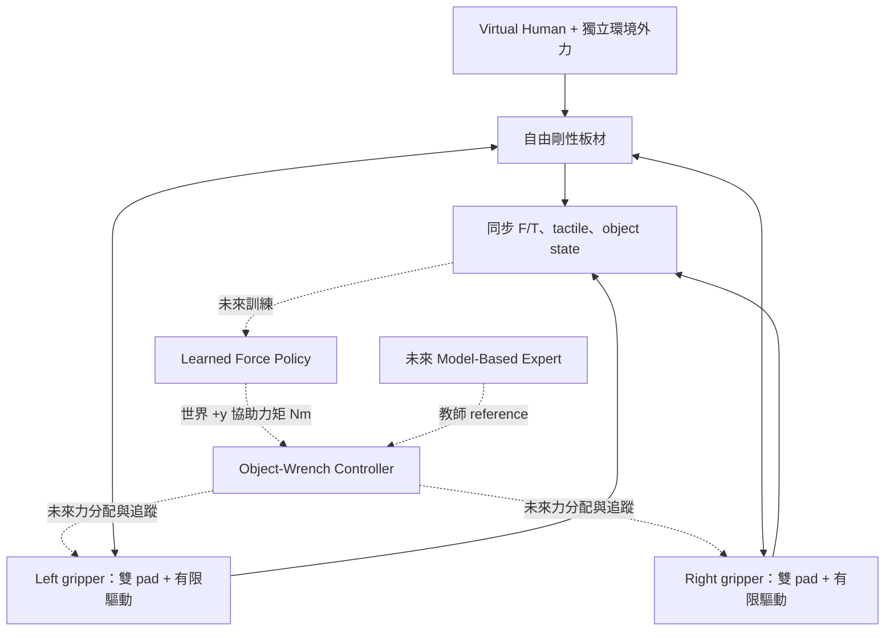

# Phase 0 v2 — Dual-Gripper Observability & Force Interface

**目前可以繼續開發並驗證小型 Model-Based Expert；尚不適合把本批感測資料當成教師示範來訓練。**

已完成兩個獨立握持端的物理模擬、A/B/C 各 10 episodes、S1/S2/S3 分析、資料契約及控制介面。判斷為 **Physical GO / Learning-Data NO-GO（正式示範收集門檻尚未通過）**。這不是「已證明力矩學習不可行」：目前缺少可信的教師力矩和追蹤驗證；tactile 的額外資訊也仍是待驗證問題。詳見 [報告 Q5–Q7](report.md)。

[v1](../phase0_tactile/README.md) 的程式、資料、報告及原 NO-GO 結論完整保留。v2 重用 v1 的平滑軌跡、限力、旋轉、參數生成和 renderer，不另建依賴環境。

## 一鍵重現

在 repository 根目錄，使用既有 `.venv`：

```bash
.venv/bin/python -m phase0_v2.scripts.run_all --output phase0_v2/results/reproduction_new
```

輸出路徑必須尚不存在。流程依序執行：v1 A/B/C 回歸與原驗證 → v2 30 episodes → v2 物理／資料／重播驗證 → 圖表與匹配分析。任何必要驗證失敗都會停止。此命令完全 headless，無 Docker、CUDA、ROS、IK 或學習模型。`--render` 可額外產生場景快照；不影響感測資料。

重現輸出：

```text
reproduction_new/
  v1_regression/   # 3 個 v1 episodes、原控制檢查與逐陣列回歸
  dual/            # v2 data、schema、分析、7 張圖、驗證結果
  provenance.json  # source/artifact SHA-256、各階段耗時
```

新環境安裝仍使用同一套版本：

```bash
python3.12 -m venv .venv
.venv/bin/python -m pip install -r phase0_tactile/requirements.txt
```

實測 macOS arm64、Python 3.12.11、MuJoCo 3.3.5、NumPy 2.2.6、Matplotlib 3.10.6，CPU。尚未驗證其他平台的逐位元一致性。一次含 render 的完整流程約 **49 s**（回歸 2.43 s、收集 38.07 s、驗證 6.28 s、分析 2.09 s）；這是本機單次量測，不是跨硬體效能保證。目前沒有為速度改用 GPU 的需求。

已保存的正式 v2 結果在 `results/pilot/`，v1 回歸在 `results/regression_v1/`。只重跑檢查或分析：

```bash
.venv/bin/python -m phase0_v2.scripts.validate_pilot --output phase0_v2/results/pilot
.venv/bin/python -m phase0_v2.scripts.analyze_pilot --output phase0_v2/results/pilot
```

如修改程式，請用新輸出路徑執行完整流程；不要把舊的 provenance 當成新結果的證明。

## 架構與本次實作邊界



實線為本次物理／資料管線，虛線為尚未實作的學習與物體層級控制。現在的 `control/baseline.py` 僅提供兩側獨立、有上限的承重與順應支撐；它**不接收 desired object wrench，不是完整雙手力分配器，也不是 expert**。

| 模組 | 現在的責任 |
| --- | --- |
| `simulation/dual_gripper.py` | 兩個獨立 gripper、單一人手 impedance、獨立環境力與動力學更新 |
| `sensing/contacts.py` | 真實接觸 → 左右 wrench、tactile、object wrench、接觸與 Newton–Euler 診斷 |
| `control/baseline.py` | 有限的 root wrench drive + 自身重力補償 + 名義承重 |
| `control/interface.py` | LearnedForcePolicy 與 ObjectWrenchController 的分離介面、力矩約定 |
| `control/expert_reference.py` | 明確回傳 unavailable；保存未來 expert 的輸入與設計需求 |
| `data/episode_schema.py` | 學生輸入白名單、資料形狀、缺值、時間同步與語意檢查 |
| `scripts/` | 回歸、收集、物理驗證、消融分析與一鍵流程 |

## 物理配置與控制力來源

板材沿用 v1 的 0.6×0.2×0.02 m、1 kg 剛性 box。左右 root 初始在 x=−0.2/+0.2 m，間距 40 cm；每個 root 各有 upper/lower pad，接觸面 0.09×0.14 m，各施加 ±40 N motor 預壓。四個 pads 並非把 v1 的兩個 pads 改名。

每個 gripper root 使用 **freejoint**，板材也是 freejoint；沒有 weld、沒有固定 world 支架。root 由記錄完整的外部虛擬 wrench 驅動，代表簡化的機器人末端力源。這些驅動是真的施加到 MuJoCo 的外力，**不是已建模的馬達／完整機械臂**。

基礎驅動採獨立 PD：位置 K=(100,100,35) N/m、D=(8,8,5) N s/m；旋轉 K=(6,0.08,6) N m/rad、D=(0.5,0.08,0.5) N m s/rad，pitch 較柔順。另補償 gripper 本身重量及重力矩，每側名義分擔半片板材重量。每側 root 驅動力範數限 35 N、力矩範數限 3 N m；pad motor 限 ±80 N，實際命令為 ±40 N。

root 的三軸平移和旋轉都由有限驅動穩定，不是硬性鎖住。任務主要為 pitch，但外力下允許高度等偏移；本次 C 的 COM z 範圍 **0.613–1.016 m**，不能將此 baseline 稱為良好的姿態追蹤器。

三類力量分開保存：

1. **接觸 wrench**：板材與 pad 真正交換的力／力矩。
2. **root 虛擬驅動與 pad motor 命令**：控制器送入引擎的量；未必等於傳到板材上的 wrench。
3. **固定支架反力**：此模型不適用，因為沒有固定 root 約束；沒有填一組假造的「量測零值」。改以兩個完整 gripper 的 Newton–Euler 平衡，檢查控制力、重力、慣性與接觸力能否閉合。

關閉 root 驅動及人手後，整組會往下落；沒有隱藏支架承重。單側移除接觸只用於驗證感測獨立性，**不是單手容錯能力驗證**。

## 人手、擾動與 A/B/C

只有一個人手握點，panel local `(0.27,−0.08,0)` m；`Fh=Kh(p*−p)+Dh(v*−v)`，力限 50 N、target speed 限 0.35 m/s，經 `mj_applyFT` 施力。初始放置後不改寫 qpos。環境力則在另一個 panel local 位置獨立施加。

- A：0.7 s 起以 0.8 s smoothstep 移動人手目標，目標角大小隨機 15–25°；5 正向、5 反向，沒有環境擾動。
- B：固定人手目標，沒有環境擾動。
- C：人手目標保持不變；向上或向下 7–22 N 的擾動，0.7 s 起施加、2.7 s 起移除，各有 0.15 s ramp。**Human intent 仍是 HOLD**。

Seed 為 `64600+i`，10 個 nuisance blocks；同 block 共用 Kh、Dh、摩擦、初始角、預壓。Kh=65–110 N/m、Dh=4–8 N s/m、摩擦 0.85–1.05，初始角 ±0.015 rad。人手速度隨目標角改變；C 位置 x∈[−0.08,0.18] m、y∈[−0.035,0.035] m、z=0。完整抽樣值在各 episode metadata。

先 settle 2 s，再記錄 4 s；dt=2 ms，100 Hz，每回合 400 筆。施力、`mj_forward`、感測在同一狀態完成後才 `mj_step`，reference timestamp 與 observation 相同。

## 座標與感測

- `wrist_ft_left/right`：`reconstructed_contact_wrench`，順序 `[Fx,Fy,Fz,Tx,Ty,Tz]`；**panel on gripper**，以各 root body frame 表示，力矩原點為各 root origin。
- `independent_object_wrenches`：上述每側訊號換號、轉到 world 並移動力矩原點到 panel COM；方向為 **gripper on panel**。
- `aggregated_object_wrench`：兩側 object wrench 相加。每筆資料保留 `gripper_pose`，供動態座標轉換／校正，不能只靠固定安裝位置轉換。
- `tactile_left/right`：每側形狀 `(2 pads,3 channels,4,4)`；官方 touch_grid channel 是 sensor-frame z/x/y、角度分箱，單位 N/bin。不是壓力影像。四個 pad 的 sensor 朝向依 MJCF 指定。[官方 plugin 說明](https://github.com/google-deepmind/mujoco/blob/3.3.5/plugin/sensor/README.md)
- `planar_tactile_*`：同一批真實接觸的局部平面分箱，channel 為法向力大小、pad-x shear、pad-y shear，不做插值。每 pad 實際 4 個承載 contact points。
- `contact_state_*`：各 pad 的承載接觸數；另記錄法向負載、加權接觸中心和最大切向相對速度。
- `object_pose`：world xyz + quaternion wxyz；`object_velocity`：world angular xyz + linear xyz。這是模擬 oracle，未經感測噪聲或延遲處理。

座標轉換使用完整力矩平移：`F_obj=−R W_force`，`T_obj=−R W_torque+(p_root−p_COM)×F_obj`。這與直接累加所有接觸點的 object wrench 做交叉驗證。

## Force demonstration 資料契約

借用 UMI-style 的同步與物體層級動作抽象；**不宣稱格式直接相容 UMI/UMI-FT，也沒有重現它們的硬體或訓練方法**。

| 檔案 | 內容 | 學生部署時可否直接使用 |
| --- | --- | --- |
| `observations.npz` | timestamp、episode_id、左右 F/T/tactile、object state、接觸資訊及衍生量 | 只能經 `student_view()` 選定的白名單；ID/time 只供組織歷史 |
| `expert.npz` | `expert_assist_torque_ref`、`total_target_torque_ref`、timestamp、validity masks | 訓練 target，不是輸入；本批全部 unavailable |
| `controller.npz` | requested／allocated／executed／realized 各量、mode、timestamp | 診斷用，不自動作為模型輸入 |
| `privileged.npz` | human goal/trajectory/wrench、external wrench、施力點、scenario、expert state availability | 否 |
| `diagnostics.npz` | raw contacts、穿透、加速度、力平衡殘差 | 驗證用 |
| `metadata.json` | 完整生成參數、seed、版本、控制增益、模型 hash | 禁止作為分類或 policy 特徵 |

`episode_id` 與 `controller_mode` 是每 episode 固定的 scalar，不重複存 400 次。schema 在 `results/pilot/schema.json`；raw contact 15 欄由 metadata 列名定義。

**未來 expert reference 的確切意義：** world frame、關於當下 panel COM 的 **+y 軸額外協助力矩，單位 N m**；正方向為右手定則，即 panel 的 +x 端往下。它不含基本承重、重力補償或 baseline 穩定控制。未來總目標需另由 baseline object reference 加上協作 torque 計算。

本次 `expert_assist_torque_ref`、`total_target_torque_ref`、`requested_object_wrench` 和 `allocated_gripper_wrenches` 都是 **NaN + false validity mask**，不是 0。`executed_actuator_commands` 是四個 pad motors 的實際輸入；`executed_virtual_drive_wrenches` 是另加到兩個 roots 的實際外部驅動；`realized_object_wrench` 是接觸得到的板材受力。沒有把三者互相改名。

Expert 可用 privileged goal、物體模型、人手／外力與限制；提出的目標是追蹤、減少人力、控制投入與平滑度，但本次沒有選定或驗證最佳化權重。原因是尚無通過驗證的 object-wrench allocator/tracker，不能確保教師目標可實現。

## S1 / S2 / S3 與後續門檻

S1 是 **v2 左右合成 wrench + 完整 object state**；S2 保留左右獨立 wrench；S3 再加入 tactile。為共同比較，S2 wrench 使用已記錄的 root pose 轉至 world／panel COM。這是同一雙夾爪資料的感測消融，**S1 不是 v1 單夾爪的重跑**。

A/C 只在同 block 的 active windows 比較，150 ms、逐點 RMSE；匹配全部 F/T、position、rotation-vector orientation、angular/linear velocity。S2 合格必須同時通過 S1。容差、各分量與全部候選數見 CSV 與報告；目前兩級均 0/10 blocks 合格，不能將未匹配的 tactile 差異當成增益。

後續順序已決定，但這次沒有實作：

1. 小型 Model-Based Expert + object-wrench allocation/tracking：先測正負 reference 的方向、可達性與接觸限制，並保證 desired／executed／realized 分開。
2. 少量教師 rollouts：檢查相似觀測歷史是否對應衝突的教師動作，再決定正式收集示範。
3. Offline MLP/GRU force regression：比較 S1/S2/S3；可以先做 S1/S2，**不必等待 tactile 被證明有效**。學生不讀 hidden goal／外力真值。
4. Offline BC 通過後，才考慮 scripted failure gates、expert intervention、資料聚合和離線重訓的簡化 CG-DAgger；它不能修補本來不可觀測的教師目標。
