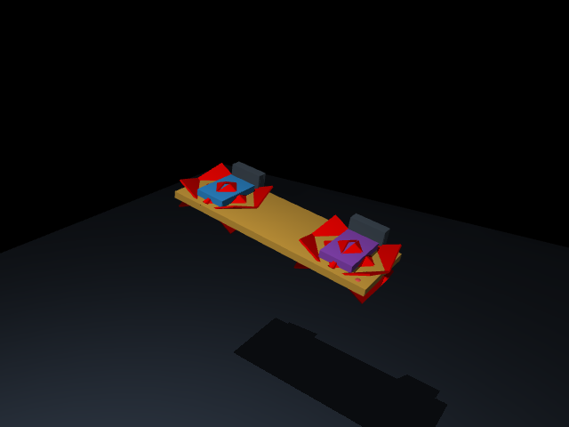
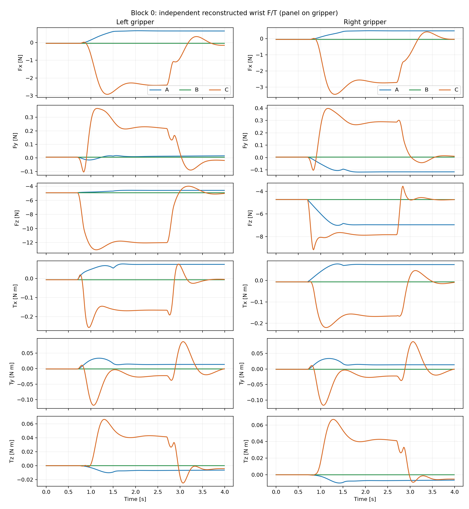
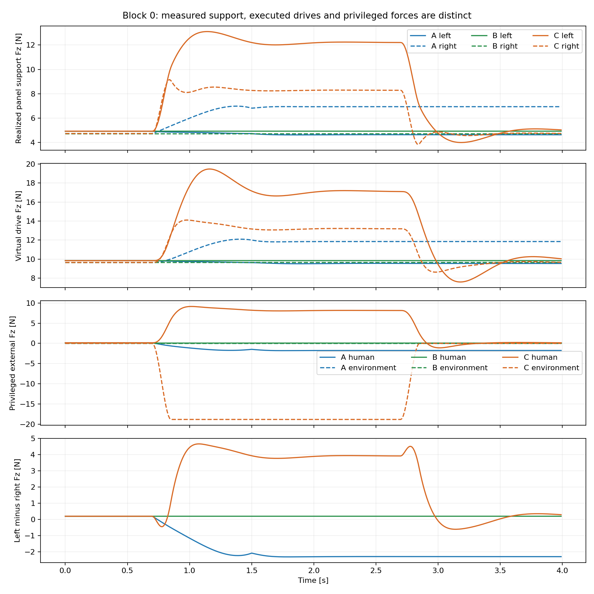
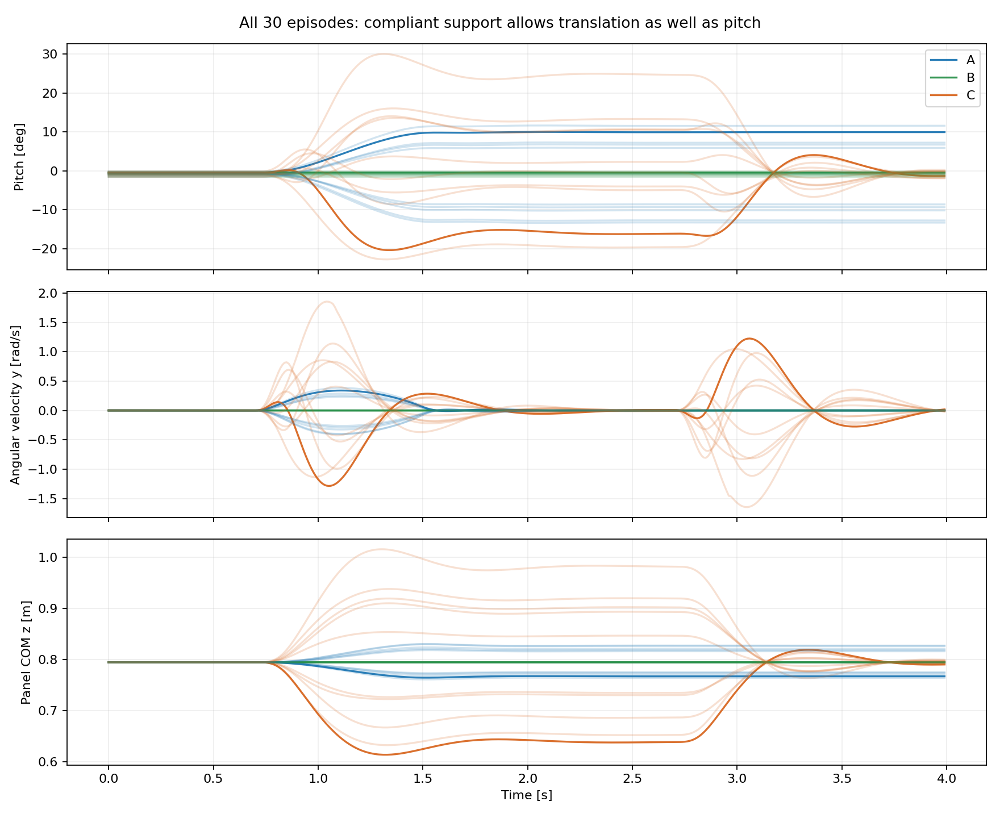
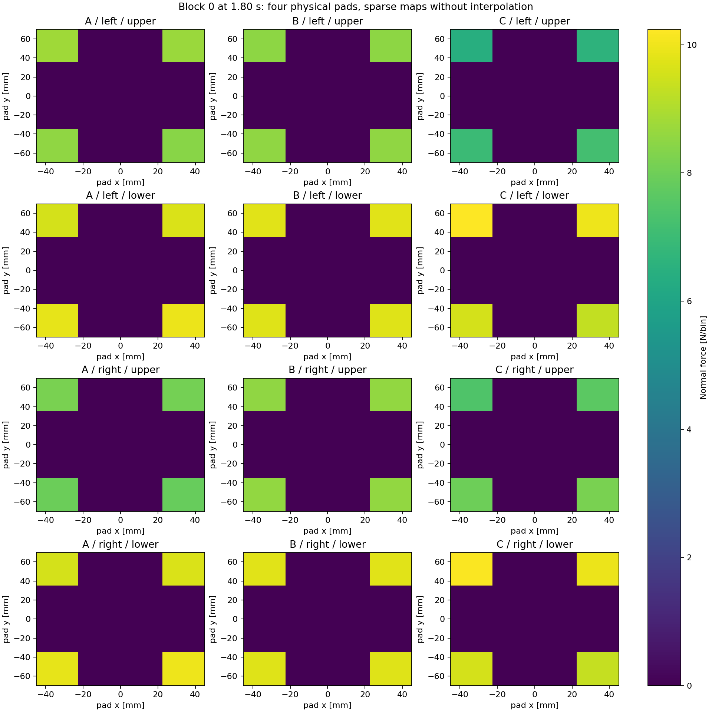
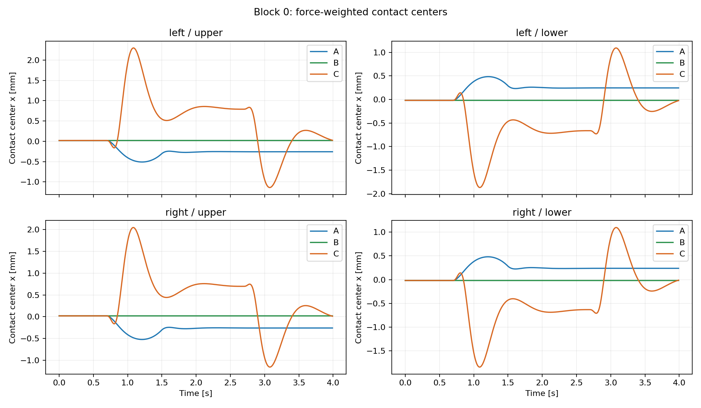
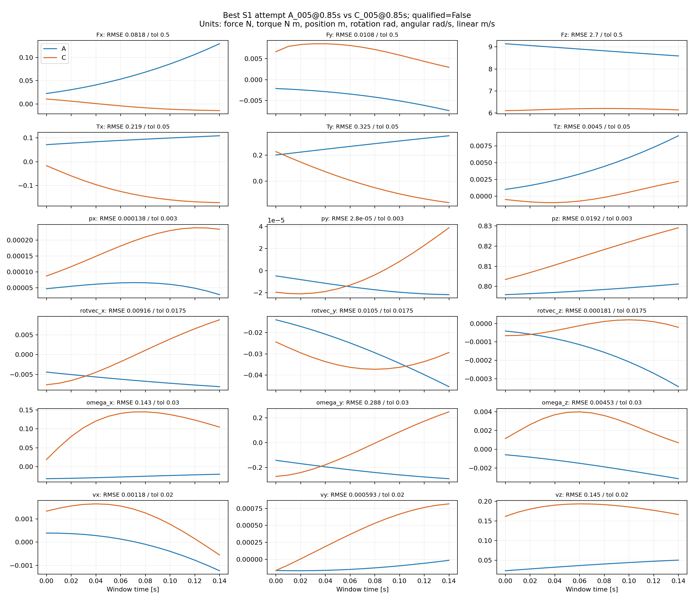
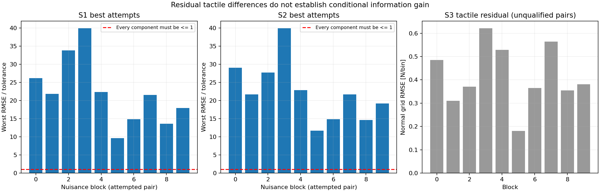

# Phase 0 v2 — Dual-Gripper Pilot 實際結果

**Physical GO。Learning-Data 尚未通過正式教師示範收集的門檻，因此本階段標為 NO-GO。可以繼續建立並驗證小型 Model-Based Expert。**

這個 NO-GO 不表示專題失敗，也不是已證明 Observation → Assistance Torque 不能學。現在有可信的感測資料，卻還沒有經驗證、可實現的「此刻應該額外協助多少力矩」教師答案。**Tactile 尚未證明有額外資訊，也不妨礙下一步先驗證 F/T + Object State 的 expert／學生方案。**

已執行 v1 A/B/C 代表性回歸、v2 A/B/C 各 10 episodes、物理對照、步長敏感性、資料契約驗證與重播。v2 每 episode 4 s、100 Hz，共 12,000 筆。沒有訓練模型、實作完整雙臂控制、建立教師示範或啟動 CG-DAgger。

## Q1. 兩個 grippers 是否真的獨立接觸、受力與支撐？

**有，在本次簡化物理模型及已測範圍內成立。** 左右 root 相隔 0.4 m，各有自己的兩個 pads、motor 預壓、F/T 與 tactile；板材與兩個 roots 都是 freejoint，沒有 weld 或 world 固定支架。

藍色為左夾爪、紫色為右夾爪；紅色含 touch_grid 視覺化，並非人手幾何模型。每側用有上限的虛擬 wrench drive 代表簡化機器人力源，尚未建模機械臂、馬達動態或 IK。

| 驗證 | 實際結果 | 證明範圍 |
| --- | --- | --- |
| v1 回歸 | 3 episodes、81 個 arrays 與原資料完全一致；原驗證通過，v1 檔案保留 | v1 未被 v2 破壞 |
| v2 正式資料 | 30 episodes、12,000 samples；每 pad 4 個承載點，總共 16 點 | 真實 sparse contact 訊號 |
| 穩定性 | 0 接觸遺失、0 地板碰撞、0 MuJoCo warnings | 本批回合保持接觸 |
| 最大穿透／線加速度 | **0.3591 mm / 5.3739 m/s²** | 無數值爆炸；軟接觸仍有穿透 |
| 板材 Newton–Euler 殘差 | 力 ≤ **5.59×10⁻¹⁴ N**；力矩 ≤ **7.96×10⁻¹⁵ N m** | 板材接觸、人手、環境、重力與慣性閉合 |
| 接觸廣義力重建 | 最大分量誤差 **3.20×10⁻¹⁴** | 與 MuJoCo panel constraint force 一致 |
| 各完整 gripper 的平衡 | 力 ≤ **5.49×10⁻¹⁴ N**；力矩 ≤ **2.91×10⁻¹⁵ N m** | root 驅動、重力、慣性與 panel contact 可區分；pad motors 是 gripper 內部作用 |
| wrench 座標轉換 | 與逐接觸點累加差 ≤ **6.04×10⁻¹⁴** | 左右 local F/T → world COM wrench 的換號及 moment arm 一致 |
| C_000 步長 2 ms → 1 ms | pitch RMSE **0.0001917 rad / 0.01098°**；最大力分量 RMSE **0.00330 N**，力矩 **0.000271 N m** | 此回合的數值敏感性低；不是所有接觸參數的收斂研究 |
| A_000 完整重播 | 五份 NPZ 全部數值／缺值 mask 一致 | 同版本環境的確定性重現 |
| 一鍵全流程重現 | 另跑 30 episodes，**1,770 個 arrays 完全一致、198 個結果檔 byte-for-byte 一致** | 一鍵指令已實際通過；重跑不算新的獨立樣本 |

另做四個 0.2 s 因果對照，均關閉人手：

- 移除左接觸：左側 contact、F/T、touch_grid 全歸零；右側仍有 `[4,4]` 個接觸。
- 移除右接觸：右側歸零，左側仍 `[4,4]`。
- 移除兩側接觸：兩側感測歸零，板材 z 從 **0.7946 → 0.5964 m**。
- 保留接觸但關閉 root 驅動：仍各 `[4,4]` 接觸，但整組向下落，板材 z 到 **0.5968 m**。保持夾緊不等於有支撐。

單側移除接觸後板材也下降約 0.10 m，因此這個對照只證明左右感測獨立，**不證明任一單側可安全接管全部負載**。固定支架反力在此模型不適用，不用一組假造的零值冒充量測。力源全部記錄為 root drive；這仍是理想化 wrench actuation，不能外推到真實雙臂可達性或安全性。

## Q2. 雙握持端增加哪些可觀測資訊？

兩個位置不同的接觸端，提供各自的負載及力矩分配。若只保留合成 object wrench，左右的分配會被消去；保留獨立 wrench 才能看到哪一側多承擔了負載。

本批各 episode 的最大 `|Fz_left−Fz_right|` 範圍為：A **1.54–3.16 N**、B **0.177–0.197 N**、C **1.50–6.82 N**。這是實際量到的負載差，不是 tactile 貢獻。C 中單側 object Fz 也可能為負，表示它在抵抗向上的擾動而向下推，不代表法向夾緊力為負；本批所有 pad 法向負載為 **25.78–42.77 N**。

圖中 root 驅動比傳到板材的支撐力多出 gripper 自重／慣性等項，所以兩者沒有互相改名。控制器能分擔負載，但尚未最佳化減少人手努力，也沒有達成良好的目標追蹤：

| 每 episode 的量，再取 10 回合範圍 | A | B | C |
| --- | ---: | ---: | ---: |
| 相對 settle 起點的最大 pitch 偏移 | 7.13–12.37° | 0.00116–0.00881° | 4.37–30.75° |
| 人手力範數最大值 | 1.27–2.79 N | 0.143–0.158 N | 2.59–12.85 N |
| 單側 root drive 最大力範數 | 10.05–12.43 N | 9.83 N 左右 | 10.53–19.53 N |
| 單側 root drive 最大力矩範數 | 0.285–0.387 N m | 0.285–0.287 N m | 0.353–0.763 N m |

root 限制為 35 N / 3 N m，這些命令在限制內。A 的人手目標為 15–25°，實際物體只轉約 7–12°，說明目前 baseline 對旋轉仍有阻抗，不能把它當成合格的協作 expert。

C 的 COM z 可達 **0.613–1.016 m**，4 s 結束時 pitch 相對基線仍可能約 −0.877° 至 +0.994°；接觸未掉落不等於 HOLD 追蹤成功。這個模型的有限柔順性使人手和環境可以同時造成 pitch 與高度變化。

**比較範圍：** S1 是 v2 的左右合成 wrench，不是 v1 單手硬體。S1→S2 是同一配置中保留負載分配的資訊差異；尚不能當成「新增第二支機械臂使辨識提高多少」的因果／效能證據。v1/v2 的支撐方式、握點與 seed 亦不同，沒有宣稱兩者分類率或控制性能可直接比較。

## Q3. 已知左右 F/T，tactile 是否仍有額外資訊？

Tactile 提供各 pad 的局部接觸位置、法向／剪切力分配及接觸中心。這些是可量測的局部狀態；但**對意圖或協助力矩目標的條件式資訊增益尚未建立**。

本次仍是每 pad 4 個 box contact points，4×4 分箱不代表 16 個獨立壓力感測單元。官方 touch_grid 是 sensor-frame 角度分箱；另存的平面 contact map 沒有插值，單位 N/bin。兩者都從相同 MuJoCo contact solver 衍生，並非獨立硬體通道。[官方定義](https://github.com/google-deepmind/mujoco/blob/3.3.5/plugin/sensor/README.md)

不能把 S1→S2 的左右負載差當成 tactile 的功勞；更不能因為 heatmap 有顏色差異，就推論它能改善教師力矩預測。

## Q4. A/C 在受力與物體狀態接近時，是否更能區分？

**Insufficient matched evidence。** 每個同 seed block 搜尋 A/C 各 31 個 active windows：起點 0.85–2.35 s、步距 50 ms、長度 150 ms，共 961 候選配對/block、9,610 對。每個分量逐時間點計算 RMSE，不僅比較均值。重疊視窗不是獨立樣本。

v2 比 v1 更完整地匹配 object state：world position xyz、由 quaternion 取得的 rotation vector xyz、angular velocity xyz、linear velocity xyz。旋轉向量採 w≥0 的小於 π 表示；容差是各分量差，不宣稱是 SO(3) geodesic 統計檢定。

| 每個分量的容差 | 值 |
| --- | --- |
| 力／力矩 | 0.5 N / 0.05 N m |
| Position | 3 mm |
| Rotation-vector orientation | 1° |
| Angular velocity | 0.03 rad/s |
| Linear velocity | 0.02 m/s |

這是工程分析容差，不是硬體噪聲校正或預先註冊的統計門檻。為共同比較，S2 的每側 F/T 利用已記錄 root pose 轉為 world／panel COM wrench。S2 配對除了每側訊號合格，也必須同時通過 S1。

| 層級 | 使用資訊／條件 | 合格 blocks | 合格候選窗 |
| --- | --- | ---: | ---: |
| S1 | 合成 object wrench + full object state | **0/10** | **0/9,610** |
| S2 | 左右獨立 wrench + full object state，且 S1 通過 | **0/10** | **0/9,610** |
| S3 | 在 S2 已匹配後檢查 tactile | **沒有合格輸入配對可供判斷** | 不適用 |

容差縮為一半或四分之一仍無合格配對。未放寬容差取得看似正面的結論。

最接近的 S1 嘗試是 A_005 與 C_005，同為 `[0.85,1.00)` s；部分關鍵差異如下，完整 18 分量及所有 block 均有 CSV：

| 分量 | RMSE | 容差 |
| --- | ---: | ---: |
| Fz | **2.703 N** | 0.5 N |
| Tx | **0.219 N m** | 0.05 N m |
| Ty | **0.325 N m** | 0.05 N m |
| COM z | **19.18 mm** | 3 mm |
| Rotation vector y | 0.599° | 1° |
| Angular velocity y | **0.2877 rad/s** | 0.03 rad/s |
| Linear velocity z | **0.1451 m/s** | 0.02 m/s |

這對時間窗的 normal-map RMSE 為 0.1672 N/bin、CoP coordinate RMSE 1.097 mm，**因 S1 未匹配，不能用來證明 S2/S3 的額外價值**。

獨立排序的最佳 S2 嘗試為 A_005 `[1.35,1.50)` s、C_005 `[0.85,1.00)` s：每側 wrench 也不合格，最壞 S2 分量為容差的 8.40 倍，S1 最壞分量為 11.68 倍。其 tactile normal RMSE 0.1802 N/bin、CoP coordinate RMSE 1.376 mm，同樣沒有條件式解釋。

同 block 已控制預壓、摩擦、Kh/Dh、初始角；每 pad contact count 固定 4。尚未控制完整 gripper 運動史／所有控制邊界條件；最佳 S1 pair 的 gripper position-coordinate RMSE 仍有 10.91 mm。自然腳本另有 A/C 外力位置與時間形狀差異，未來模型可能利用這些捷徑。

### 等效 wrench 負對照

保持同初始狀態、同兩側控制器和接觸邊界條件，一份模擬在人手握點施力，另一份在 COM 施加同力及補償力矩，持續 3 s。這是 wrench 表示的一致性檢查，**不是另一份真實 C/HOLD teacher demonstration**。

最大差：左 F/T **2.97×10⁻¹³**、右 F/T **1.83×10⁻¹³**（各分量 N 或 N m）；兩側 tactile **8.88×10⁻¹⁴ N/bin**；pose **8.88×10⁻¹⁶**（m 或 quaternion component）。差異為浮點誤差量級。第二個夾爪沒有打破「同理想剛體、同合 wrench 歷史、同接觸／控制邊界條件」的等價性。

這不證明所有來源辨識都不可能，也不證明力矩 policy 不能學；它只防止把等價施力表示誤當成新感測資訊。

## Q5. Observation → Expert Assistance Torque 的資料介面可靠嗎？

**介面與同步檢查已完成；有效 expert demonstrations 尚未建立。**

| 欄位 | 狀態與意思 |
| --- | --- |
| observations | 左右 F/T、tactile、object pose/velocity、contact state 真實同步記錄 |
| `expert_assist_torque_ref` | **unavailable**，NaN + false validity；world +y、panel COM、Nm，基本承重／穩定控制之外的額外協助力矩 |
| `total_target_torque_ref` | unavailable；不拿現有 drive 或 contact torque 代替 |
| `requested_object_wrench` | unavailable，尚無 object-level reference command |
| `allocated_gripper_wrenches` | unavailable，尚無接受 desired object wrench 的 allocator |
| `executed_actuator_commands` | 四個 pad motor 命令，實際送入 MuJoCo |
| `executed_virtual_drive_wrenches` | 兩個 roots 實際接受的 bounded world wrench |
| `realized_object_wrench` | 兩側接觸真正施加到板材的合 wrench |
| controller mode | `independent_bounded_support_only` |

所有 observation、expert placeholder、controller 與 privileged timestamps 對齊；缺值檢查通過。學生輸入採白名單，不包含 human goal、environment force、scenario、metadata 或 expert internal state。這是資料邊界驗證；未來訓練程式仍需沿用這個入口，不能任意合併所有檔案當輸入。

`LearnedForcePolicy.predict(history)` 與 `ObjectWrenchController.step(reference, observation)` 已分離。此介面不代表已經有可用學生或完整控制器。現在沒有把 measured F/T、現有 drive、scenario 固定數值重新命名成 teacher labels。

## Q6. Expert force reference 能由目前歷史合理預測嗎？

**尚未驗證，不是已驗證不能預測。Experiment 5 未完成。** 本批有效 expert labels 數量為 **0**，因此無法測試相似觀測歷史是否要求互相衝突的教師動作。

可以根據 privileged goal、模型、人手力與擾動定義候選 expert，但目前沒有驗證 reference → allocation → realized contact wrench 的追蹤與可達性。將任意 torque 計算式直接存成「正確答案」會跨過這個尚未完成的物理檢查。

下一個小型驗證應先確認：正／負的 object torque reference 是否被正確執行、gravity/baseline 與額外 assistance 是否分開、飽和與接觸限制如何影響實際 torque。通過後，再用少量 A/B/C 教師 rollouts 檢查觀測與 target 的一致性。

**不需要先證明 tactile 有用，才能做這一步。** 可以先建立 S1 或 S2 expert/policy baseline，再以 S3 做增益消融。A/C 是生成與評估標籤；未來學習的主要輸出是力矩，並不要求先把 A/C 分類正確。

## Q7. 是否適合建立 Expert Controller 並收集 Offline Demonstrations？

應分開兩個行動：

- **建立並小規模驗證 Expert Controller：建議繼續。** 物理、接觸感測、力平衡及同步管線已具備；這是下一個要解決的具體缺口。
- **正式收集教師示範並進入 Offline Learning：目前不建議。** 先取得可實現、方向正確、同步且可由觀測支持的教師目標；不能只因為資料格式準備好了就開始訓練。

建議下一個完成條件是：在固定 baseline 上，對一組小幅正／負協助力矩完成有數值容差的追蹤測試，清楚記錄 requested、allocated、executed、realized 四層；維持接觸且不超出限制。接著用少量教師回合檢查是否存在相似觀測卻要求不同 action 的衝突，再決定正式資料收集的 GO。追蹤容差與教師目標需在該次測試前明確定義。

本次的結論依然是 **Physical GO / Learning-Data NO-GO（尚未通過收集門檻）**。原因是教師可信度和 observation–target 關係仍缺證據；沒有把 tactile 匹配失敗當成整個 force-learning 專案的否定。

## 證據與重現

- [一鍵指令、模型與介面](README.md)
- [資料 schema](results/pilot/schema.json)
- [物理與因果對照](results/pilot/physics_controls.json)
- [資料／力平衡／重播驗證](results/pilot/dataset_validation.json)
- [回合統計](results/pilot/episode_summary.csv)
- [S1/S2 配對摘要](results/pilot/matched_pairs.csv)、[每個分量 RMSE 與容差](results/pilot/matching_components.csv)
- [v1 回歸](results/regression_v1/regression.json)
- [機器可讀分析](results/pilot/analysis.json)
- [全流程重現核對](results/pilot/full_reproduction_check.json)、[source/artifact 雜湊](results/pilot/provenance.json)

力與力矩檢查是 MuJoCo 引擎內部的一致性證據，不是實體材料校正。接觸力和施力 API 的定義依 [MuJoCo 3.3.5 API](https://mujoco.readthedocs.io/en/3.3.5/APIreference/APIfunctions.html#mj-applyft)。目前沒有真人、硬體、感測噪聲、完整雙臂工作空間或實際加工操作的驗證。
