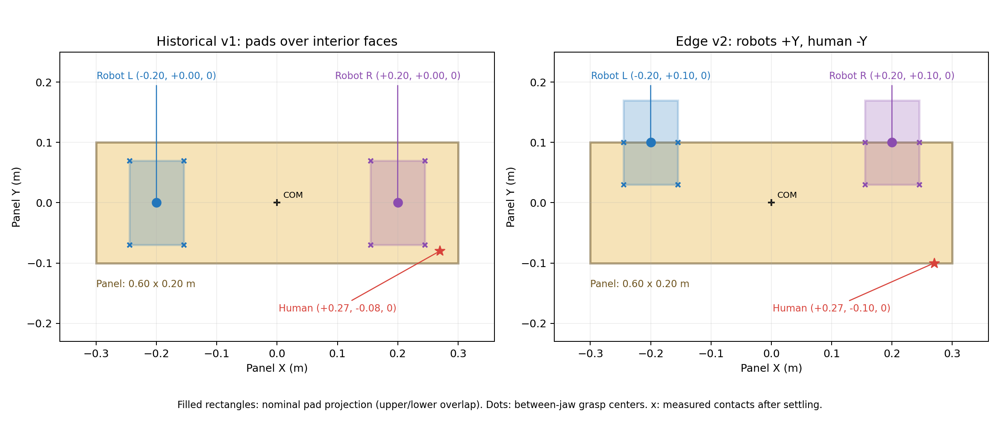
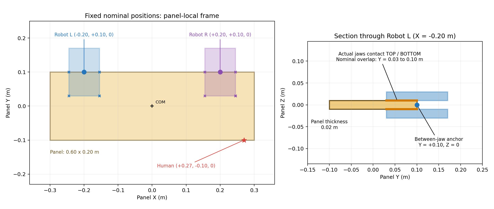

# Edge-grasp scenario v2 — geometry correction and evidence

使用者選擇：**Robot L/R 在同一條長邊，人手在對側長邊**。凍結為 `enpm645-dual-gripper@2.0.0`。舊 `scenario_v1.json`、舊 MJCF 與實驗資料保留不動。

## 結論

原問題不是單純畫錯：舊 robot grasp centers 是 [-0.2,0,0] / [0.2,0,0]，表示兩片 jaw 之間的 frame origin；pad 接觸板材上下表面的內側區域，沒有把實體 pad 放進板材體積。舊 human point=[0.27,-0.08,0] 是板材內部的虛擬施力點。

新 nominal grasp centers 全部用 panel-local m：

| Actor | Position | 幾何語意 |
|---|---|---|
| Robot L | [-0.20,+0.10,0] | +Y 長邊，兩片 jaw 之間的 frame；非材料接觸點 |
| Robot R | [+0.20,+0.10,0] | +Y 長邊，兩片 jaw 之間的 frame；非材料接觸點 |
| Human | [+0.27,-0.10,0] | -Y 側面上的單一虛擬 spring-damper attachment |

Panel 範圍 X=[-0.30,+0.30]、Y=[-0.10,+0.10]、Z=[-0.01,+0.01] m。兩側 pads 的名義 Y footprint=[0.03,0.17]；只與 panel 上下表面的 Y=[0.03,0.10] 部分接觸。Robot L 的 X patch=[-0.245,-0.155]；Robot R=[0.155,0.245]。Upper/lower 接觸面 Z=+0.01/-0.01。完整 `grasp_semantics` 在新 config 中。

## 圖與 native MuJoCo 證據






圖中 nominal geometry 由 compiled MuJoCo 的 geom/body/site transforms 產生；叉號是 settle 後實際正向承載的 contact manifold。3D 圖直接用 MuJoCo Renderer，僅隱藏 touch-grid plugin debug overlays，沒有更改 collision geometry、量測值或物理姿態。紅球代表虛擬 human site，不是已建立的人手碰撞模型。兩個 robot 仍是簡化 free-root grippers，沒有完整手臂。

## 已驗證

- A/B/C 與 5 秒 scripted reference test 全部通過資料讀回：共 1,700 transitions / 8,500 physics steps。
- 新版重跑 **372 個 arrays 完全一致**；正負 reference 不改變 support-only 的物理軌跡。
- 新版 A/B/C 另做每 2 ms 的接觸與 Newton–Euler 檢查，共 6,000 steps；四片 pads 每步都至少 3 個正向承載 contact，無 floor contact、無 warnings。
- 最大 penetration=0.000597 m（<0.001 m）；線性/角動量、gripper balance 與 wrench frame transport 殘差均 <1e-8。
- 新版 individual pad-removal / both-removed / drives-disabled controls 通過，證實兩側接觸獨立且沒有固定 world fixture。
- 原 v1 四集資料 validator 通過；原 A episode 重播 93 arrays 完全相同。另在舊 geometry 上比較新 human adapter 與原 DualPilot dynamics，通過 1e-10 絕對誤差檢查。
- 17 項原介面、geometry 與 hardware freeze tests 通過，記錄在 `unit-tests.txt`。

## 固定硬體契約

硬體 `enpm645-edge-dual-gripper-virtual-human@1.0.0` 已由 compiled MuJoCo model 擷取並鎖定，hash=`698e60dd3d6bdf181b95b93674538e1632349408a8b1cfb255241344da53d302`。規格檔為 `phase1a/config/hardware_v1.json`，包括 root/pad mass、inertia、joint limits/damping/armature、motor limits/gear、contact parameters、sensor frames 及 single human spring-damper/force limits。載入場景與開始 episode 時核對；每集 metadata 保存 hardware_id/version/hash，讀回亦驗證。測試確認修改 mass、friction、人手 stiffness 或規格檔會被拒絕。

## 固定位置的界線

**固定名義 local grasp geometry，不是把 roots 焊死在 world，也不是強行把每個接觸點鎖死。** Robot roots 和 panel 仍為 free joints，只有 pad slides / 接觸 / 原 support-only drives；runtime 不改寫 qpos。實際 contact points 隨 compliance 和滑移變動。

新版測試的 robot grasp-frame 相對名義位置最大偏移 **1.053 cm**；human attachment local error <1e-12 m。這不等同於零滑移握持，亦未證明 force closure 或完整手臂可達性。若後續要求固定相對姿態的控制精度，應由 Track B 明定並驗證容許誤差。

Desired torque tracking 仍 unavailable、所有 expert labels 仍 invalid。這次修正 geometry/semantics，沒有新增 force allocator 或 expert。

## 版本與重現

- model_hash: `d0c70a9a473264f50feca7731952537667dbd4dc4b1c09b687916d09ab615623`
- config_hash: `c1b5bb05810538b9ec9348bf9c06390133c18926f4461bd27c5bdf56e3aa52e7`
- `geometry/geometry_audit.json`：名義/settled geometry、實際 contact points、source hashes。
- `geometry_validation.json`：新版物理檢查及舊版回歸。
- `replay_validation.json`：資料讀回、新版 exact replay、零 reference 對照；其中舊 v2 controls 明確只代表舊模型。

```bash
uv run --locked python -m phase1a.scripts.run_edge_scene --output results/phase1a/reproduction-edge
```

輸出路徑必須全新。一般 smoke/controller 接入需指定 `--scenario-config phase1a/config/scenario_v2.json`；歷史 `run_all` 的預設仍是 v1，以保留舊實驗重現語意。
