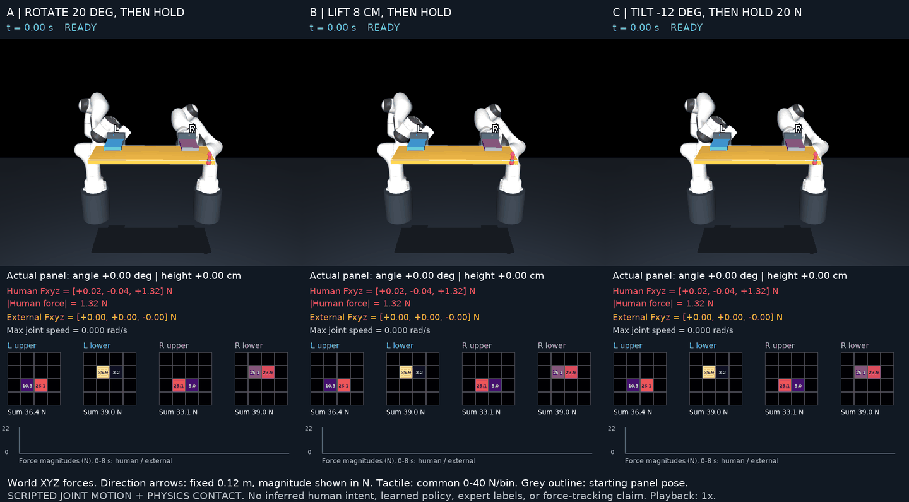

# A/B/C — Moving dual-Panda demonstrations v1

這組展示讓兩支 Panda 與板材實際移動，再停留或承受固定外力。使用既有 Scenario 3.0.0 / Hardware 2.0.0；新增獨立 `scripted-motion/1.0` protocol，不覆寫原 A/B/C position-hold smoke tests。

[三段同步比較 MP4](visuals/ABC_comparison.mp4) · [A 旋轉](visuals/A.mp4) · [B 抬升停留](visuals/B.mp4) · [C 承受固定外力](visuals/C.mp4)



## 動作與人的力量

每段 8 秒、原速播放。人手 target 在 0.6 秒開始移動；機器人預定軌跡在 1.4 秒開始，3.8 秒完成，接著保持。人手 force 是沿用 spring-damper 模型計算的互動力，隨時間改變；下表列的是量測峰值，並非固定命令。所有力都以 **world XYZ / N** 表示，+Z 向上。

| 範例 | 板材實測動作，最後 5.5–8 s 平均相對起點 | 人手峰值及當時方向 | 外力 |
| --- | --- | --- | --- |
| A | +20.00°，同時抬升 3.05 cm，之後停住 | 2.05 N，2.22 s：`[-0.84,-0.04,-1.87]`，主要向下及 −X | 無 |
| B | 抬升 7.98 cm，之後停住 | 5.41 N，2.18 s：`[+0.02,-0.02,+5.41]`，主要向上 | 無 |
| C | −11.94°，之後停住並承重；受載後高度較起點低 0.45 cm | 4.20 N，2.18 s：`[-0.29,-0.03,+4.19]`，主要向上 | 4.0–4.3 s 漸增，4.3–8 s 固定 `[0,0,-20]` N |

人手方向會變：例如 A 動作期間主要往下施力，停留時約有 +Z 1.27 N 的平均支撐分量。畫面逐幀顯示完整 Fxyz，不能只用峰值描述整段。人手 application point 保留 panel-local `[+0.27,-0.10,0] m`；外力 application point 沿用原設定並記錄實際 world 位置。

紅箭頭是人手力方向；橘箭頭是外力方向；青色點是人手 target。箭頭固定長度 0.12 m，**不編碼力的大小**，大小看數字與曲線。灰框為板材起始姿態。四張 tactile 圖共用 0–40 N/bin 色階，表示各 pad 的 normal force 分布，不是壓力 Pa。

## 實作與驗證

IK 在獨立 planning model 上計算軌跡；正式 execution 只送 14 軸 position commands，由 actuator torque、手臂動力學及四片 pads 的真實接觸傳遞負載。正式 stepping 不寫 qpos、不施加 gripper-root virtual wrench。人手與外力只作用於板材。

**這是 scripted joint-motion demonstration。** 人手領先及手臂開始移動的時間均事先設定，不是根據人的力量觸發。沒有意圖推論、object-wrench tracking、Expert、學習或訓練；`desired_assist_torque` 留為 NaN，`expert_label_valid=false`。不修改既有 World +Y / Panel COM / Nm 介面。

| 物理量 | A | B | C |
| --- | --- | --- | --- |
| 最大關節角變化 (rad) | 0.7103 | 0.2734 | 0.3030 |
| 最大關節速度 (rad/s) | 0.4470 | 0.1721 | 0.1884 |
| 最少接觸點數，L upper/lower、R upper/lower | 4/4/3/4 | 4/3/4/4 | 2/3/3/4 |
| 最大 pad 接觸穿透 (mm) | 0.509 | 0.378 | 0.471 |
| 最小關節限制餘裕 (rad) | 0.0400 | 0.1479 | 0.1480 |
| 停留角度峰對峰 (deg)，5.5–8 s | 0.00041 | 0.00029 | 0.00057 |
| 停留高度峰對峰 (mm)，5.5–8 s | 0.174 | 0.0003 | 0.223 |

三段各檢查 4,000 physics steps：沒有非預期穿透超過 0.01 mm、MuJoCo warnings 或 actuator saturation，接觸與 joint limits 均通過；最大線性力平衡殘差小於 8.4e−9 N。檢查範圍受既有模型碰撞排除設定約束。A 的最小關節餘裕只有 0.04 rad，因此本結果只支持這些具體軌跡，不表示任意翻轉或 90° 翻轉都已驗證。

與前一次獨立執行逐陣列比對，各 case 的 **56 arrays 完全相同**，共 168 arrays；見 [replay_validation.json](replay_validation.json)。詳細數據：[A](A/report.json)、[B](B/report.json)、[C](C/report.json)。

## 資料與重現

每段包含：

- `samples.npz`：800 筆、100 Hz 的同時刻 post-command / pre-step snapshots，包括 joint states、commands、actuator forces、EE poses、gripper states、tactile、object state，以及人手／外力 truth、完整 qpos/qvel。
- `physics.npz`：4,000 筆、500 Hz 的 contact、penetration、joint limits、warnings、saturation 與 force-balance diagnostics。
- `planned_commands.npz`：801 個、100 Hz 的 2×7 joint-position command knots，execution 線性插值至 500 Hz。
- `report.json`：版本、時間設定、source hashes、驗收指標。

這是含 privileged truth 的展示診斷檔，不是正式 policy dataset，不能把整個 `samples.npz` 直接當學習 observation；既有 policy whitelist 不變。呈現影片時才在獨立 renderer 還原已記錄 qpos，不參與物理執行。

在 repo root 執行，輸出須為新目錄：

```bash
uv sync --locked
uv run --locked python -m phase1b.demos.motion_examples --output results/phase1b/reproduction-motion
uv run --locked python -m phase1b.demos.render_examples --input results/phase1b/reproduction-motion --output results/phase1b/reproduction-motion/visuals
```

渲染需本機 `ffmpeg`。四支 MP4 都是 20 fps、160 frames、8 秒；GIF 是 10 fps、80 frames、8 秒。畫面來源與 renderer hash 記錄在 [frame_capture.json](visuals/frame_capture.json)。
